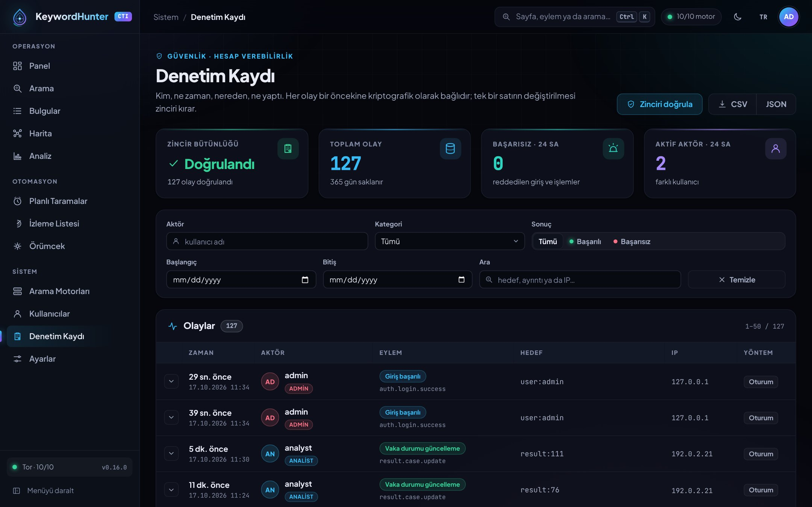
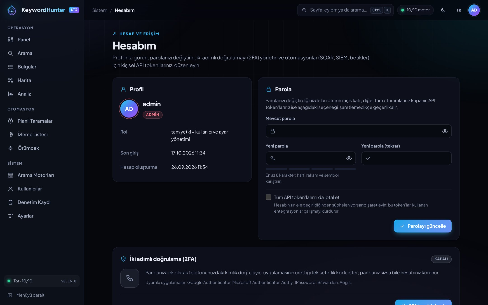
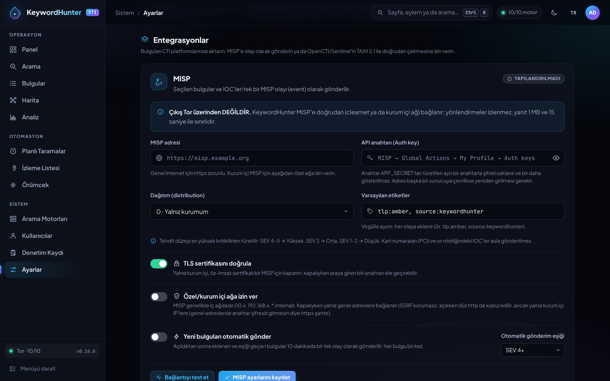

<div align="center">

<picture>
  <source media="(prefers-color-scheme: light)" srcset="docs/assets/banner-light.svg">
  
</picture>

[](https://github.com/mehmetyasinuzun/Keyword-Hunter/actions/workflows/ci.yml)
[](https://github.com/mehmetyasinuzun/Keyword-Hunter/releases)
[](go.mod)
[](LICENSE)
[](docs/FRONTEND.md)

**A single-binary CTI platform that searches onion search engines concurrently over Tor,
classifies findings automatically, extracts IOCs, monitors sites and alerts on new threats.**

[Features](#-features) · [Quick start](#-quick-start) · [Engines](#️-search-engines) · [Screenshots](#️-screenshots) · [Security](#️-security-model) · [**Türkçe**](README.md)

</div>

---

<p align="center">
  
  
</p>

## 🎯 Why KeywordHunter?

- **One console, the whole loop:** search → classify → extract IOCs → watch → alert → export as STIX.
- **Tor-only, local-first:** all outbound traffic goes through Tor; data lives only in your SQLite file. No CDN, no telemetry.
- **Single binary, zero runtime deps:** pure Go (no CGO), six platforms, ready-made Docker image.
- **Built for teams:** admin / analyst / viewer roles, case status and analyst notes, scheduled scans, webhooks (Slack / Discord / Teams / SIEM), personal API tokens for SOAR/SIEM automation.
- **Analyst experience:** command palette (<kbd>Ctrl</kbd>+<kbd>K</kbd>), keyboard shortcuts, light/dark/system theme, Turkish + English UI, mobile-friendly.

## ✨ Features

| Module | Capabilities |
|---|---|
| 🔎 **Search** | Parallel search across 10 live-verified onion engines, per-engine live progress (SSE), pagination, automatic severity (1-5) and category (EN · TR · RU · DE · ES · PT signals; accent/case-insensitive, word-boundary stem matching), dedup |
| 🗂️ **Findings** | Multi-dimensional filters, sorting, bulk actions, inline editing, **case management** (new → investigating → confirmed / dismissed + notes), CSV · JSON · **STIX 2.1** |
| 🧬 **Tagging + IOC** | Fetches the page over Tor; Unicode-aware keyword extraction; email, BTC/XMR, IP, hash, card (Luhn), SSH/API keys, onion IOCs; pivot search |
| 🕸️ **Map** | Query → engine → result relationship graph (radial / tree / force), node expansion (adds on-page links), focus, add to watchlist |
| 📈 **Analytics** | Time series, source / query / severity / category breakdowns, domain map, theme-aware charts |
| ⏱️ **Scheduled scans** | Minute-level intervals, diffing for *new* URLs only, per-scan and global webhooks, thresholds, test send |
| 📡 **Watchlist** | Uptime %, change detection via visible-text hash, Cloudflare/captcha detection, triggered and manual screenshots, timeline |
| 🛰️ **Engines** | Live health, latency, success rate, enable/disable (actually affects search), automatic Tor circuit renewal (NEWNYM) |
| 🕷️ **Crawler** | Polite, depth/page-bounded BFS from a seed .onion; discovered pages become findings |
| 🍪 **Site profiles** | Per-host Cookie + User-Agent + JS rendering (behind login walls / captchas) |
| 🧾 **Audit log** | Who did what, when, from where: sign-ins, roles, cases, settings, tokens and exports; **SHA-256 hash chain** for tamper evidence, one-click chain verification, filters, CSV/JSON export, retention (`AUDIT_RETENTION_DAYS`) |
| 🔐 **Two-factor auth** | RFC 6238 TOTP (QR + manual key), single-use recovery codes, enforce with `REQUIRE_2FA=admins\|all`, secrets AES-256-GCM encrypted with a key derived from `APP_SECRET`, admin reset |
| 🔗 **Integrations** | Read-only **TAXII 2.1 server** for OpenCTI / Microsoft Sentinel (fixed collections, stable STIX objects, token via Basic/Bearer); push selected findings to **MISP** as a single event (encrypted key, SSRF-guarded, optional auto-push) — [docs/INTEGRATIONS.md](docs/INTEGRATIONS.md) |

## 🚀 Quick start

```bash
git clone https://github.com/mehmetyasinuzun/Keyword-Hunter.git
cd Keyword-Hunter
docker compose up -d --build
docker compose logs app | grep -A3 "yönetici parolası"   # admin password generated on first run
```

Open **http://localhost:8080** · health: `/healthz` · prebuilt image: `ghcr.io/mehmetyasinuzun/keyword-hunter:latest`.

Persistent data lives in `./data/` (`keywordhunter.db`, `.env`, `logs/`, `screenshots/`). Since v0.17.0 new log files and
screenshots are owner-only (`0600`; in Docker the owner is uid 10001 `kh`), so `tail data/logs/…` on the host fails with
permission denied: use `docker compose logs app` (logs also go to the console) or `sudo`, and run host-side log shippers
as uid 10001 or inside the container. Existing files keep their permissions.

Local run (Go 1.27+): `./run.sh` (macOS/Linux) · `.\run.ps1` (Windows) · `./run.sh release` builds six platform binaries into `dist/`.
Tor must be listening (Tor Browser 9150 / tor service 9050) — set `TOR_PROXY` in `.env`.
See the [Turkish README](README.md) for the full configuration table (`.env` variables).

## 🛰️ Search engines

Verified on 2026-09-18 over a real Tor circuit, in three rounds with two queries
([`pkg/search/engines.go`](pkg/search/engines.go)). Enabled by default: **Tordex, Amnesia, Tor66,
Onionway, OnionLand, Torland, Excavator, TorNet, Submarine, Danex**. Engines that require a captcha
(OSS, Torgle), JavaScript (Torgol), have an empty index (DeepSearches) or are unreachable (Torch,
Ahmia onion, FindTor) ship disabled and can be enabled from the **Search Engines** screen. User
customisations survive engine list updates.

## 🖼️ Screenshots

| | |
|---|---|
|  **Sign in** |  **Search** |
|  **Findings** |  **Map** |
|  **Analytics** |  **Watchlist** |
|  **Engines** |  **Scheduled scans** |
|  **Audit log** |  **My account** — 2FA & API tokens |
|  **Integrations** — MISP & TAXII 2.1 |  **Dark theme** |
|  **Command palette** |  **Light theme** |

## 🛡️ Security model

The tool visits hostile sites and displays their text, so the UI assumes **untrusted input** everywhere.

- **Strict CSP** — `script-src 'self'; style-src 'self'`, with no `'unsafe-inline'` anywhere in the policy: no inline scripts, `on*=` handlers, `<style>` blocks or `style=""` attributes (including HTML built by JS — runtime values are set through the CSSOM), enforced by automated tests over every template and JS file and over the rendered output of every page. Even if dark-web text slipped into the HTML, the browser would neither execute it nor apply inline CSS that could exfiltrate data or overlay a fake UI.
- bcrypt, per-IP and global login lockout, sliding + absolute session lifetime, session revocation on password change.
- Two-factor authentication (TOTP, RFC 6238) with one-time recovery codes and optional enforcement — see [Two-factor authentication](#-two-factor-authentication-2fa).
- RBAC (admin / analyst / viewer) enforced server-side; navigation filtered server-side.
- Tamper-evident audit log: every state-changing action (sign-ins, denied access, user/settings changes, deletions, exports) is recorded as "who did what, when, from where" in an append-only, SHA-256 hash-chained table; the admin-only `/audit` page shows where the chain breaks if a row is altered, deleted or truncated. Secrets (passwords, cookies, tokens, webhook paths) are never stored; retention via `AUDIT_RETENTION_DAYS` (default 365, `0` = forever) keeps the chain verifiable through an anchor.
- CSRF on every write endpoint (including the search form); Fetch-Metadata-protected `GET /logout`.
- Personal API tokens: `kh_` + 256 random bits, stored only as a SHA-256 hash and shown once; read/write scope can never exceed the owner's current role; account and security management endpoints refuse tokens (see [API](#-api)).
- SSRF guards: expand / analyze / watch / render are `.onion`-only; webhook and screenshot targets cannot resolve to internal addresses; redirects are not followed.
- Secrets masked in logs, API and HTML; CSV export protected against formula injection.
- Integrations: the MISP API key is stored AES-256-GCM-encrypted with a purpose-separated key derived from `APP_SECRET`, never appears in any response, page or audit row, and must be re-entered when the URL moves to another server; MISP egress is direct clearnet/intranet, not Tor (public targets only unless "allow private networks" is on, no redirects, 1 MB / 15 s caps). TAXII accepts API tokens only (no cookies, no writes); card and phone numbers are shared neither over TAXII nor to MISP; plain-http MISP is allowed only to internal IPs. Details: [docs/INTEGRATIONS.md](docs/INTEGRATIONS.md).
- All assets embedded (no CDN); `govulncheck`, `golangci-lint` (incl. gosec) and CodeQL (Go, JavaScript, Actions; also weekly) on every push/PR; Dependabot. Releases ship SPDX SBOMs (binaries + image), a keyless cosign-signed `SHA256SUMS.txt`, a digest-signed image and GitHub build provenance attestations — see [Verifying releases](#-verifying-releases). Docker runs as non-root with `no-new-privileges`.

Report vulnerabilities privately — see [SECURITY.md](SECURITY.md).

## ✅ Verifying releases

Every release is produced by [`release.yml`](.github/workflows/release.yml) on GitHub Actions and signed keylessly with
that workflow's OIDC identity ([Sigstore](https://www.sigstore.dev/) / Fulcio) — no signing key is stored in the repo.
Next to the binaries each release carries:

| File | Contents |
|---|---|
| `SHA256SUMS.txt` | SHA-256 digests of every binary and of the binary SBOM |
| `SHA256SUMS.txt.sigstore.json` | cosign signature bundle for `SHA256SUMS.txt` (certificate + transparency log entry) |
| `keywordhunter-<version>.spdx.json` | SPDX SBOM of the binaries (embedded Go modules and toolchain) |
| `keywordhunter-<version>-image.spdx.json` | SPDX SBOM of the Docker image (linux/amd64) — informational copy, not covered by `SHA256SUMS.txt`; its signed form is the SBOM attestation bound to the image digest (below) |

You need [cosign](https://docs.sigstore.dev/cosign/system_config/installation/) v3+ (signatures use the Sigstore bundle format) and
the [GitHub CLI](https://cli.github.com/) (`gh attestation`; it calls the GitHub API, so run `gh auth login` or set `GH_TOKEN` first).
Without `gh` you can still download the assets from the Releases page and run steps 2 and 3 and the image `cosign verify`.
Replace `0.17.0` with the version you are verifying.

```bash
# 1) Download the assets (or grab them from the Releases page)
gh release download v0.17.0 --repo mehmetyasinuzun/Keyword-Hunter --dir kh-0.17.0 && cd kh-0.17.0

# 2) Signature of the checksum list: only this repo's release workflow (a v* tag, or a manual run from master) may have signed it
cosign verify-blob \
  --bundle SHA256SUMS.txt.sigstore.json \
  --certificate-identity-regexp '^https://github\.com/mehmetyasinuzun/Keyword-Hunter/\.github/workflows/release\.yml@refs/(tags/v[0-9]+\.[0-9]+\.[0-9]+|heads/master)$' \
  --certificate-oidc-issuer https://token.actions.githubusercontent.com \
  SHA256SUMS.txt

# 3) Files must match the signed list (downloaded a single binary? add --ignore-missing)
sha256sum -c SHA256SUMS.txt

# 4) Build provenance: the binary was built by this repo's release workflow (a v* tag or master, on a
#    GitHub-hosted runner); the source commit is the sourceRepositoryDigest in the output
gh attestation verify keywordhunter-0.17.0-linux-amd64 \
  --repo mehmetyasinuzun/Keyword-Hunter \
  --cert-identity-regex '^https://github\.com/mehmetyasinuzun/Keyword-Hunter/\.github/workflows/release\.yml@refs/(tags/v[0-9]+\.[0-9]+\.[0-9]+|heads/master)$' \
  --deny-self-hosted-runners
```

Docker image (the tag resolves to a digest; pinning `@sha256:…` is strictest):

```bash
cosign verify ghcr.io/mehmetyasinuzun/keyword-hunter:0.17.0 \
  --certificate-identity-regexp '^https://github\.com/mehmetyasinuzun/Keyword-Hunter/\.github/workflows/release\.yml@refs/(tags/v[0-9]+\.[0-9]+\.[0-9]+|heads/master)$' \
  --certificate-oidc-issuer https://token.actions.githubusercontent.com

# Provenance (the image was built by this workflow)
gh attestation verify oci://ghcr.io/mehmetyasinuzun/keyword-hunter:0.17.0 \
  --repo mehmetyasinuzun/Keyword-Hunter \
  --cert-identity-regex '^https://github\.com/mehmetyasinuzun/Keyword-Hunter/\.github/workflows/release\.yml@refs/(tags/v[0-9]+\.[0-9]+\.[0-9]+|heads/master)$' \
  --deny-self-hosted-runners

# Signed SBOM (the signed counterpart of the release's SBOM file; --format json prints its content)
gh attestation verify oci://ghcr.io/mehmetyasinuzun/keyword-hunter:0.17.0 \
  --repo mehmetyasinuzun/Keyword-Hunter \
  --cert-identity-regex '^https://github\.com/mehmetyasinuzun/Keyword-Hunter/\.github/workflows/release\.yml@refs/(tags/v[0-9]+\.[0-9]+\.[0-9]+|heads/master)$' \
  --deny-self-hosted-runners \
  --predicate-type https://spdx.dev/Document/v2.3
```

On macOS without `sha256sum`: `shasum -a 256 -c SHA256SUMS.txt`. Releases before v0.17.0 only ship `SHA256SUMS.txt`
(no signature, SBOM or attestations).

## 🔌 API

Every `/api/` endpoint accepts either a browser session (cookie + `X-CSRF-Token` header on writes) or a **personal API token** — e.g. `GET /api/results?q=&minCriticality=&tag=&limit=&page=`, `GET /api/export/results?format=csv|json`, `GET /api/export/stix`, `GET /api/artifacts?type=&value=`, `POST /api/results/:id/case`, `GET|POST /api/watchlist`, `GET|POST /api/scheduled`, `GET /api/engines`, `GET /api/whoami`, `POST /api/integrations/misp/push`. `GET /healthz` is public.

**Error contract:** every `/api` error returns `{"error": "<human-readable message>", "code": "<stable code>"}` (some endpoints also keep `"success": false` for older clients; the 2FA lockout adds `retryAfter`). Automations should match on **`code`** (`session_expired`, `csrf_failed`, `role_required`, `session_required`, `token_invalid`, `token_revoked`, `token_expired`, `token_read_only`, `2fa_required`, `too_many_requests`, `invalid_request`, `not_found`, `tor_unreachable`, `site_unreachable`, `site_timeout`…); the `error` text is a translation and may change. Message language: the `lang` cookie, otherwise `Accept-Language` (`tr` | `en`, q-values honoured), otherwise Turkish. HTTP status codes do not depend on the language.

```bash
curl -sS -H "Authorization: Bearer kh_wrong" -H 'Accept-Language: en' https://keywordhunter.example/api/results
# 401 {"code":"token_invalid","error":"Invalid API token"}
```

**TAXII 2.1** (read-only, API token only — Bearer or as the Basic password): `GET /taxii2/` (discovery), `GET /taxii2/kh/collections/`, `GET /taxii2/kh/collections/{id}/objects/?added_after=&limit=&next=&match[type]=&match[id]=`, `GET …/objects/{object-id}/`, `GET …/manifest/`. Collections: `findings-all`, `findings-high` (severity 4–5), `indicators`. OpenCTI / Sentinel setup, curl examples and the MISP mapping: [docs/INTEGRATIONS.md](docs/INTEGRATIONS.md).

```bash
curl -sS -H 'Accept: application/taxii+json;version=2.1' -u ":$KH_TOKEN" \
  'https://keywordhunter.example/taxii2/kh/collections/findings-high/objects/?limit=500'
```

### Personal API tokens (SOAR / SIEM / scripts)

Create a token on **My Account → API tokens** (`/account`). The value (`kh_…`) is shown **exactly once**; the server only keeps its SHA-256 hash. Send it in the `Authorization` header of every request:

```bash
export KH_TOKEN='kh_…'   # read it from a vault / secret store
# Read: latest critical findings
curl -sS -H "Authorization: Bearer $KH_TOKEN" \
  'https://keywordhunter.example/api/results?minCriticality=4&limit=20'
# Write ("write" scope): no CSRF header needed when no session cookie is sent
curl -sS -X POST -H "Authorization: Bearer $KH_TOKEN" -H 'Content-Type: application/json' \
  -d '{"status":"investigating","note":"SOAR: triage opened"}' 'https://keywordhunter.example/api/results/42/case'
# Check the token's identity and effective role
curl -sS -H "Authorization: Bearer $KH_TOKEN" https://keywordhunter.example/api/whoami
```

- **Scope:** `read` is downgraded to viewer and can never write; `write` acts with the owner's **current** role (demoting the user demotes the token immediately). Viewers can only create `read` tokens.
- **Lifetime:** 7 / 30 / 90 / 180 / 365 days or no expiry; revocable at any time. Revoked, expired or unknown tokens, and tokens of disabled/deleted users, get `401 {"error": …, "code": "token_invalid|token_revoked|token_expired"}` with `WWW-Authenticate: Bearer`.
- **`/api/` only, header only:** HTML pages, `/events` (SSE) and screenshot files ignore tokens; query-string values such as `?token=` are never read.
- **CSRF rule:** only requests authenticated by a Bearer token *without* a session cookie skip CSRF. If a session cookie is also present, the session path is used and CSRF is required.
- **Endpoints tokens cannot call** (`403 {"code": "session_required", "error": …}`): `/api/tokens*` (token management), `/api/me/*` (password, 2FA), `/api/users*`, `/api/settings/*`, `/api/site-profiles*`, `/api/alert-config*` (webhook integrations), `/api/integrations/misp/config` and `/api/integrations/misp/test` (MISP settings). A leaked token cannot mint tokens, change passwords or manage accounts and integrations.
- **Password changes and incident response:** when an admin resets a user's password, that user's sessions are signed out **and all of their API tokens are revoked** (`tokensRevoked` in the `user.password.reset` event). A user's own password change does not revoke tokens by default (so integrations keep working); if you suspect a compromise, tick "Also revoke all my API tokens" under **My Account → Password** (`"revokeTokens": true` in the `POST /api/me/password` body). Disabling a user also invalidates their tokens immediately.
- **Audit:** token creation/revocation (`token.create`, `token.revoke`), rejected token attempts (`auth.token.failure`) and **every audited action** performed with a token (writes, exports, access denials) are recorded with `auth_method=token` and the token prefix (`kh_XXXXXXX`). Read-only requests (e.g. `GET /api/results`) do not produce their own audit rows; they only update the token's last-used time and IP (at most once a minute), shown in the token list.

## 🔐 Two-factor authentication (2FA)

Enable it under **My Account → Two-factor authentication** (`/account#security-2fa`): add the QR code (or the key, grouped in fours) to an authenticator app (Google/Microsoft Authenticator, Authy, 1Password, Bitwarden, Aegis…), confirm a 6-digit code together with your current password and store the **10 recovery codes** (`xxxx-xxxx`, single use, shown once; copy or download as `.txt`).

- **Sign-in:** a correct password does **not** create a session for a 2FA user. A server-side pending login (5-minute TTL, referenced by an `HttpOnly`, `SameSite=Strict` cookie scoped to `/login`) leads to `/login/2fa`, which auto-submits once 6 digits are typed and offers a recovery-code mode. Five wrong codes invalidate the pending login; code failures also count toward the per-IP login lockout, so restarting with the password cannot bypass it. Attempts are reserved atomically before verification, so concurrent requests cannot exceed the 5-attempt cap. Changing your password also drops any pending login started with the old one. The login page never reveals whether an account has 2FA before the password is verified.
- **TOTP:** HMAC-SHA1, 6 digits, 30 s step, ±1 step clock skew, constant-time comparison, replay protection (the last accepted step is persisted; the same or an older step is rejected).
- **Turning off / regenerating codes** requires the password plus a current code (or a recovery code); failures count toward the IP lockout. Regenerating invalidates all previous codes. **Enabling also requires the current password**, so a stolen session cannot enrol its own authenticator and lock the owner out; enabling 2FA signs out your other sessions.
- **Admin reset** (`/users` → shield icon, `POST /api/users/:id/2fa/reset`) removes a user's enrolment and recovery codes and signs out their sessions (lost device). Admins cannot reset **their own** 2FA through this endpoint — they turn it off on My Account with password + code, so a hijacked admin session cannot strip its own second factor.
- **Enforcement (`REQUIRE_2FA=none|admins|all`, default `none`):** an unenrolled user in scope is redirected to `/account#security-2fa` (with a banner) on every page; session API calls get `403 {"code": "2fa_required", "error": …}` except the enrolment endpoints; that user's API tokens are rejected with 403. The legacy `.env` administrator (`ADMIN_USER`) that is not a row in the users table (e.g. after renaming it in `/settings` or deleting the bootstrap row) cannot enrol, so while a policy is active it **cannot sign in** and any existing session is ended; use an account from `/users`. With `REQUIRE_2FA` set, the app **refuses to start** without a persisted `APP_SECRET` (unwritable `.env`), because enrolment would be disabled and everyone in scope would be stuck on My Account.
- **`APP_SECRET`** (64 hex chars) — TOTP secrets are encrypted with AES-256-GCM using a key derived via HKDF-SHA256 and bound to the user (AAD). If it is missing at startup a new one is generated with `crypto/rand` and appended to the active `.env` as a single line, keeping your comments and other lines (the value is never logged). **Back it up:** if it is lost or changed, stored secrets can no longer be decrypted; users can still sign in with recovery codes, otherwise an admin must reset their 2FA. If the `.env` file is not writable the generated secret only lives for that run and 2FA enrolment is disabled.
- **Endpoints** (interactive session only, never with an API token): `GET /api/me/2fa`, `POST /api/me/2fa/setup` → `{qrDataURI, secret, otpauthURI}`, `POST /api/me/2fa/enable {password, code}` → `{recoveryCodes}`, `POST /api/me/2fa/disable {password, code}`, `POST /api/me/2fa/recovery-codes {password, code}`, `POST /api/users/:id/2fa/reset` (admin).
- **Audit:** `2fa.enable`, `2fa.disable`, `2fa.recovery.regenerate`, `2fa.reset_by_admin`, `auth.2fa.challenge`, `auth.2fa.success`, `auth.2fa.failure` (reason `bad_code`, `replay`, …); `auth.login.success` records the `mfa` method. Secrets and codes are never logged.

## 💾 Backup & restore

A backup is a consistent copy taken with SQLite `VACUUM INTO` **while the app runs** (WAL content included, writers are
not blocked) and every backup is verified with `PRAGMA integrity_check`. It is a single file (no `-wal`/`-shm`).

| Variable | Default | Description |
|---|---|---|
| `BACKUP_DIR` | — (off) | Directory for scheduled backups (Docker: `/data/backups`; the entrypoint maps the template's relative `backups` there). A relative path is resolved against the working directory; Settings shows the absolute path. Empty = scheduled backups off; on-demand download and `keywordhunter backup` still work |
| `BACKUP_INTERVAL_HOURS` | `24` | Scheduled backup interval in hours (1–8760) |
| `BACKUP_KEEP` | `7` | Newest backups kept in the directory (1–1000); older ones are deleted |

- **On demand (UI):** Settings → Backup → **Download backup now** (admin only, interactive session + CSRF; not callable
  with an API token) → `POST /api/admin/backup` → `keywordhunter-<version>-<UTC timestamp>.db`. The copy is staged next to
  the database (same volume) and its name is unlinked before streaming. Audited as `backup.download` **after** the
  transfer: file name, total size, bytes actually sent and whether it completed (an interrupted download is recorded as
  failed). The browser holds the whole file in memory before saving it: for multi-GB databases use the command line or
  scheduled backups instead.
- **Scheduled:** with `BACKUP_DIR` set, a backup is written **atomically** every `BACKUP_INTERVAL_HOURS` (0600 temp file →
  `VACUUM INTO` → `integrity_check` → fsync → rename); the newest `BACKUP_KEEP` are kept, older ones deleted (other files
  in the directory are never touched; the backup just written is never rotated away, even if the clock was set back).
  The first run is ~2 min after startup, or at most one interval after the last successful backup; a failure is
  retried after 1 hour. On shutdown a running backup is cancelled and its temp file removed; leftovers of a killed
  process (`.keywordhunter-backup-*.tmp`, older than 1 hour) are swept on the next run. Results are logged, audited
  (`backup.scheduled`) and shown under Settings → Backup.
- **Command line** (does not start the server, runs no migrations, opens the source **read-only** — its bytes and
  journal mode are not changed; for a stopped database in WAL mode SQLite may leave empty `-wal`/`-shm` side files, so
  run it as the app's user). The report is printed in Turkish (`Sonuç: OK` = result OK); use `-json` for scripts:

```bash
keywordhunter backup -out /backups/kh.db        # source: DB_PATH (environment → .env); override with -db
keywordhunter verify-db /backups/kh.db          # integrity_check + audit chain + schema version; problems → exit code 1
keywordhunter verify-db -json /backups/kh.db
# Docker, app running:
docker compose exec -u kh app /app/keywordhunter backup -out /data/manual-backup.db
# Docker, app stopped (the entrypoint drops to the kh user):
docker compose run --rm --no-deps app /app/keywordhunter verify-db /data/backups/keywordhunter-0.17.0-20261017T030000Z.db
```

**What is (not) included:** every table (findings, IOCs, cases, users, audit log, settings); **sessions are removed**
(session IDs are bearer credentials — everyone signs in again after a restore; the removal is verified on the final
file and a backup that still holds a session is failed). Passwords are bcrypt hashes, API tokens SHA-256 digests, 2FA
and MISP secrets are encrypted with `APP_SECRET`. **In plaintext** (needed to work after a restore): **site-profile
cookies** (`site_profiles.cookies` — your sessions on monitored forums/markets) and **webhook URLs** (global alert and
per scheduled search; Slack/Discord/Teams path tokens). A leaked backup therefore exposes those sessions and webhook
tokens without `APP_SECRET`: keep backups access-restricted and encrypted, and rotate those cookies/webhooks if a backup
leaks. Screenshot PNGs (`SCREENSHOT_DIR`) live on disk, not in the database; back them up as files.

> ⚠️ **`APP_SECRET` is NOT in the backup and must never be stored inside or next to it.** Keep the deployment's
> `APP_SECRET` (the `.env` line) separately in a safe place (e.g. a password vault): anyone holding both could decrypt
> the 2FA/MISP secrets.

### Upgrading from v0.16

v0.17 versions the schema (`PRAGMA user_version`) and adopts an older database on its first start; there is no way
back to an older binary afterwards. **Before** the first start, take a migration-free backup with the **new** binary:
`keywordhunter backup -out pre-v0.17.db` (Docker, after pulling the new image and before `up -d`:
`docker compose run --rm --no-deps app /app/keywordhunter backup -out /data/pre-v0.17.db`).

### Restore

1. **Stop** the app (`docker compose stop app` or Ctrl+C). Never replace the file under a running app.
2. Verify the backup: `keywordhunter verify-db backup.db` → last line `Sonuç: OK` (Docker, with the app stopped:
   `docker compose run --rm --no-deps app /app/keywordhunter verify-db /data/backup.db`).
3. Move the current database aside **together with its WAL** (after an unclean stop the `-wal` holds committed
   transactions of the old database; it must neither be lost nor applied to the restored file); the `-shm` is a
   rebuildable index: `mv keywordhunter.db keywordhunter.db.old; [ ! -e keywordhunter.db-wal ] || mv keywordhunter.db-wal keywordhunter.db.old-wal; rm -f keywordhunter.db-shm`
4. Copy the backup to the `DB_PATH` name (Docker: `/data/keywordhunter.db`; the entrypoint fixes ownership).
5. Make sure `.env` holds **the same deployment's `APP_SECRET`**, then start the app. A backup from an older version is
   upgraded automatically on startup; a backup from a **newer** version is refused by an older binary (upgrade first).

**If `APP_SECRET` differs or is lost:** findings, users, passwords, the audit log and API tokens work normally, but
**2FA secrets and the MISP API key cannot be decrypted**. 2FA users sign in with a **recovery code** and re-enrol from
My Account; for users without codes an admin uses `/users` → reset 2FA. Re-enter the MISP key under Settings → MISP. If
the only admin is locked out (no recovery code either), as a last resort with the app stopped (the image ships no
`sqlite3`; run it on the host against the mounted `./data/keywordhunter.db`):
`sqlite3 keywordhunter.db "DELETE FROM user_recovery_codes WHERE user_id=(SELECT id FROM users WHERE username='admin'); DELETE FROM user_2fa WHERE user_id=(SELECT id FROM users WHERE username='admin');"`
and re-enrol after signing in.

## 🗑️ Retention

| Variable | Default | Description |
|---|---|---|
| `RESULT_RETENTION_DAYS` | `0` (forever) | Days to keep findings, counted from when a search **last returned** the finding (first sighting if never seen again). Once a day, findings no search has returned for longer are deleted together with their tags, IOCs, MISP push records, graph nodes (including the expansion subtree) and screenshots (files included); findings whose case status is **Investigating** or **Confirmed** are kept |
| `SCREENSHOT_RETENTION_DAYS` | `0` (forever) | Days to keep screenshots (row + PNG); screenshots of an Investigating/Confirmed case's URL (evidence) are kept |

- **Still-listed findings are not purged:** every search that returns a known finding refreshes its last-seen time, so
  a page that is still live is not deleted and later re-created as "new" (no repeated webhook alert, MISP push or TAXII
  publication). A finding that disappears for longer than the period and then reappears is treated as new again. Only
  Investigating/Confirmed cases are exempt — a *Dismissed* finding that stops appearing is deleted like any other.
- A graph node or screenshot is only removed with a finding when no other finding still uses that URL; screenshots of
  watchlist URLs are governed by `SCREENSHOT_RETENTION_DAYS` only. Screenshot files are deleted right after each batch
  of 500 rows, so an interrupted run leaves no orphaned PNGs behind; files that cannot be deleted are shown as a warning
  under Settings → Retention.
- Deletion is **secure**: purges run with `PRAGMA secure_delete` (the app connection uses `secure_delete=FAST`
  throughout) and the WAL is truncated afterwards, so purged text is not left readable in the database file. **Existing
  backups are not affected**: data stays in earlier backups until they are rotated out (`BACKUP_KEEP` ×
  `BACKUP_INTERVAL_HOURS`; 7 days by default) — size `BACKUP_KEEP` accordingly.
- Each run is logged and audited as `retention.purge` (counts only); the active policy (including
  `AUDIT_RETENTION_DAYS`) and the last run are shown under Settings → Retention (admin).

## 🧑‍💻 Development

```bash
go build ./... && go vet ./... && go test -race ./...
```

Frontend contract: [docs/FRONTEND.md](docs/FRONTEND.md) · Integrations (TAXII 2.1, MISP): [docs/INTEGRATIONS.md](docs/INTEGRATIONS.md) · Contributing: [CONTRIBUTING.md](CONTRIBUTING.md) · Changelog: [CHANGELOG.md](CHANGELOG.md).

## ⚖️ Legal

For security researchers and SOC/CTI teams only. Use in an **isolated environment** and **within your legal authority**. Not for unauthorized access or illegal activity; the user bears all responsibility.

<div align="center"><sub>Built by <a href="https://github.com/mehmetyasinuzun">Mehmet Yasin Uzun</a> · MIT License</sub></div>
