<div align="center">

<picture>
  <source media="(prefers-color-scheme: light)" srcset="docs/assets/banner-light.svg">
  
</picture>

[](https://github.com/mehmetyasinuzun/Keyword-Hunter/actions/workflows/ci.yml)
[](https://github.com/mehmetyasinuzun/Keyword-Hunter/releases)
[](go.mod)
[](LICENSE)
[](https://github.com/mehmetyasinuzun/Keyword-Hunter/pkgs/container/keyword-hunter)
[](docs/FRONTEND.md)


**Tor ağındaki onion arama motorlarını eşzamanlı tarayan, bulguları otomatik sınıflandıran,
IOC çıkaran, siteleri izleyen ve yeni tehditleri anında bildiren — tek ikili dosyadan oluşan
CTI platformu.**

[Özellikler](#-özellikler) · [Hızlı Başlangıç](#-hızlı-başlangıç) · [Motorlar](#️-arama-motorları) · [Ekran Görüntüleri](#️-ekran-görüntüleri) · [Mimari](#-mimari) · [Güvenlik](#️-güvenlik-modeli) · [**English**](README.en.md)

</div>

---

<p align="center">
  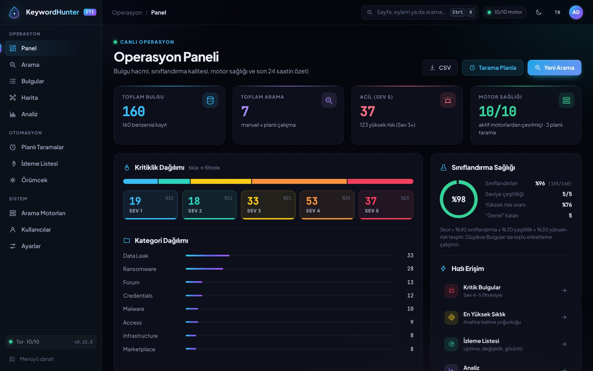
  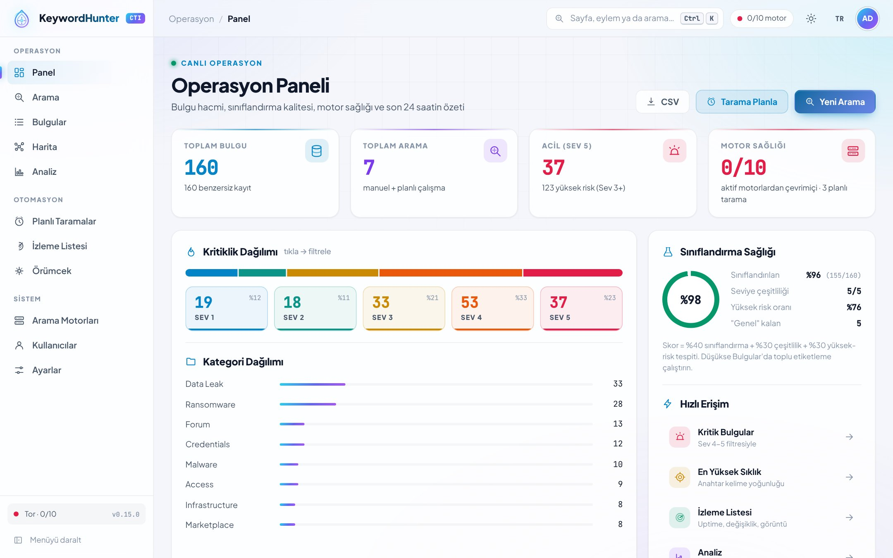
</p>

## 🎯 Neden KeywordHunter?

- **Tek konsol, tüm akış:** ara → sınıflandır → IOC çıkar → izle → bildir → STIX ile dışa aktar.
- **Tor-only, yerel-öncelikli:** tüm dış trafik Tor üzerinden çıkar; veri yalnızca sizin SQLite dosyanızda. CDN yok, telemetri yok.
- **Tek ikili, sıfır bağımlılık:** saf Go (CGO yok), altı platform, Docker imajı hazır.
- **Ekip için tasarlandı:** admin / analist / izleyici rolleri, vaka durumu ve analist notları, planlı taramalar, webhook (Slack / Discord / Teams / SIEM), SOAR/SIEM otomasyonu için kişisel API token'ları.
- **Analist deneyimi:** komut paleti (<kbd>Ctrl</kbd>+<kbd>K</kbd>), klavye kısayolları, açık/koyu/sistem teması, Türkçe + İngilizce arayüz, mobil uyumlu.

## ✨ Özellikler

| Modül | Yetenekler |
|---|---|
| 🔎 **Arama** | 10 canlı doğrulanmış onion motorunda paralel tarama, motor bazında canlı ilerleme (SSE), sayfalama, otomatik kritiklik (1-5) ve kategori (TR · EN · RU · DE · ES · PT sinyaller; aksan/büyük-küçük harf duyarsız, kelime sınırlı kök eşleşmesi), tekilleştirme |
| 🗂️ **Bulgular** | Çok boyutlu filtre (sorgu, metin, motor, kategori, min. kritiklik, etiket, vaka), sıralama, toplu işlemler (etiketle / kritiklik / kopyala / sil), satır içi düzenleme, **vaka yönetimi** (yeni → inceleniyor → doğrulandı / elendi + not), CSV · JSON · **STIX 2.1** |
| 🧬 **Etiketleme + IOC** | Sayfayı Tor'dan çeker; Unicode/Türkçe duyarlı anahtar kelime çıkarımı; e-posta, BTC/XMR, IP, hash, kart (Luhn), SSH/API anahtarı, onion IOC'leri; pivot arama |
| 🕸️ **Harita** | Sorgu → motor → sonuç ilişki grafiği (radial / tree / force), düğüm derinleştirme (sayfadaki linkleri grafa ekler), odaklan, izlemeye ekle |
| 📈 **Analiz** | Zaman serisi, kaynak / sorgu / kritiklik / kategori dağılımları, domain haritası, tema duyarlı grafikler |
| ⏱️ **Planlı Tarama** | Dakika bazlı periyot, yalnızca *yeni* URL diff'i, tarama-özel ve genel webhook, eşik, test gönderimi |
| 📡 **İzleme Listesi** | Onion siteleri için uptime %, görünür-metin hash'i ile değişiklik tespiti, Cloudflare/captcha sezimi, tetiklenen ve manuel ekran görüntüsü, zaman çizelgesi |
| 🛰️ **Motorlar** | Canlı sağlık, yanıt süresi, başarı oranı, aç/kapat (aramayı gerçekten etkiler), tüm motorlar düşerse otomatik Tor devre yenileme (NEWNYM) |
| 🕷️ **Örümcek** | Tohum .onion'dan derinlik/sayfa sınırlı, nazik BFS site taraması; keşfedilen sayfalar bulgu olur |
| 🍪 **Site Profilleri** | Host bazlı Cookie + User-Agent + JS render (giriş duvarı / captcha arkası) |
| 👥 **Ekip** | Çok kullanıcılı, rol tabanlı erişim (admin / analist / izleyici), parola sıfırlama, oturum iptali, SOAR/SIEM için kişisel **API token'ları** (okuma/yazma kapsamı, süre sonu, iptal) |

### Arayüz

- **Nightwatch tasarım sistemi** — tek kaynaklı token'lar, açık / koyu / sistem teması (ilk boyamada sunucu tarafında uygulanır, yanıp sönme yok).
- **Komut paleti** (<kbd>Ctrl</kbd>/<kbd>⌘</kbd>+<kbd>K</kbd>): sayfalara git, dark web'de ara, bulgularda filtrele, tema/dil değiştir.
- **Klavye öncelikli:** <kbd>/</kbd> arama · <kbd>G</kbd> sonra <kbd>D</kbd>/<kbd>R</kbd>/<kbd>H</kbd>/<kbd>A</kbd>/<kbd>P</kbd>/<kbd>I</kbd>/<kbd>C</kbd>/<kbd>M</kbd> sayfalar · <kbd>?</kbd> yardım.
- Akıcı mikro-etkileşimler: sayfalar arası görünüm geçişleri, kademeli giriş, sayaç animasyonları, imleç takipli ışık, iskelet yükleyiciler — `prefers-reduced-motion` tam desteklenir.
- Erişilebilirlik: anlamsal işaretleme, odak tuzaklı modallar, klavyeyle tam gezinme, "içeriğe geç" bağlantısı.

## 🚀 Hızlı Başlangıç

### Docker (önerilen)

```bash
git clone https://github.com/mehmetyasinuzun/Keyword-Hunter.git
cd Keyword-Hunter
docker compose up -d --build
docker compose logs app | grep -A3 "yönetici parolası"   # ilk kurulumda üretilen parola
```

Arayüz: **http://localhost:8080** · Sağlık: `http://localhost:8080/healthz`

Hazır imaj (etiketli sürümlerde GHCR'a yayınlanır):

```bash
docker pull ghcr.io/mehmetyasinuzun/keyword-hunter:latest
```

- Varsayılan olarak yalnızca bu makineden erişilir; Tor konteyneri host'a port yayınlamaz.
- LAN/sunucudan erişim: `KH_BIND=0.0.0.0 docker compose up -d` — mutlaka güçlü parola, HTTPS ters vekil (Caddy/nginx) ve `WEB_SECURE_COOKIES=true`.
- Kalıcı veri `./data/` altında: `keywordhunter.db`, `.env`, `logs/`, `screenshots/`. `docker compose down -v && rm -rf data` tümünü siler.
- Windows: `temiz_baslat.bat` aynı adımları yapar.

### Yerel (macOS / Linux / Windows, Go 1.27+)

| Platform | Başlat | Not |
|---|---|---|
| macOS / Linux | `./run.sh` (veya `make run`) | `.env` yoksa şablondan oluşturur, Tor portunu kontrol eder |
| Windows (PowerShell) | `.\run.ps1` | `winget install GoLang.Go` ile Go kurun |
| Windows (cmd) | `build_and_run.bat` | `run.ps1`'i çağıran ince sarmalayıcı |
| Her platform | `./run.sh release` | `dist/` altına 6 platform için ikili üretir |

Tor: **Tor Browser** 9150, **tor servisi** 9050 portunu dinler (`brew install tor`, `apt install tor`, Windows'ta Tor Expert Bundle). `.env` içindeki `TOR_PROXY` bunu göstermeli.
Ekran görüntüsü için Chrome/Chromium/Brave/Edge otomatik bulunur; bulunamazsa `CHROME_BIN=/yol/chrome`. Docker imajında Chromium hazır gelir.

## 🛰️ Arama Motorları

Liste 2026-09-18'de gerçek Tor devresi üzerinden, üç turda ve iki sorguyla doğrulandı
([`pkg/search/engines.go`](pkg/search/engines.go)). Varsayılan aktif: **Tordex, Amnesia, Tor66,
Onionway, OnionLand, Torland, Excavator, TorNet, Submarine, Danex**. Captcha isteyen (OSS, Torgle),
JavaScript gerektiren (Torgol), boş dizinli (DeepSearches) veya erişilemeyen (Torch, Ahmia onion,
FindTor) motorlar pasif gelir ve **Arama Motorları** ekranından açılabilir. Motor listesi
değiştiğinde kullanıcı özelleştirmeleri korunur.

## 🖼️ Ekran Görüntüleri

| | |
|---|---|
| 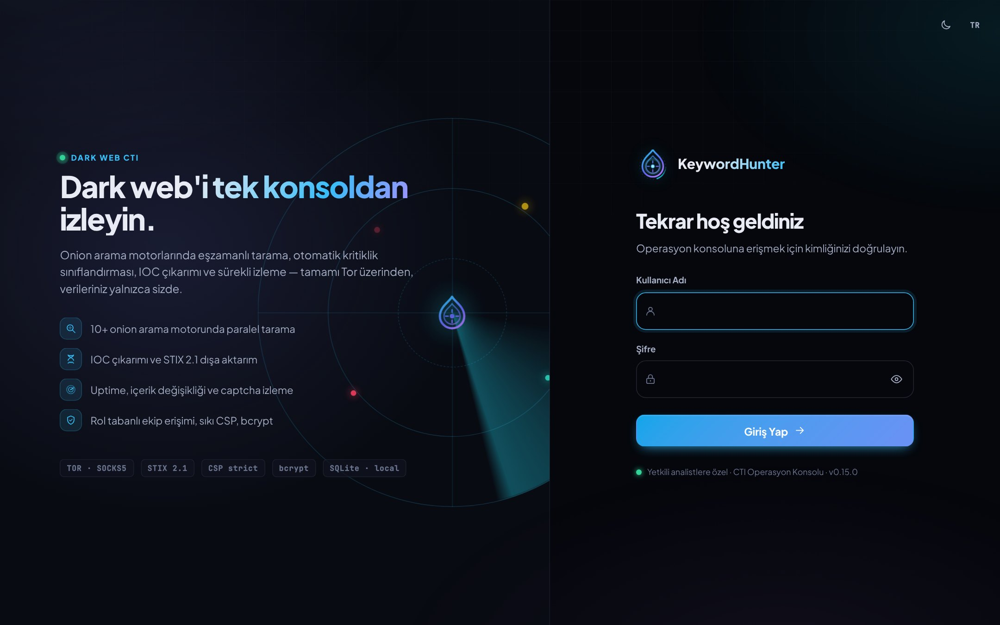 **Giriş** — canlı radar, kilitleme geri sayımı | 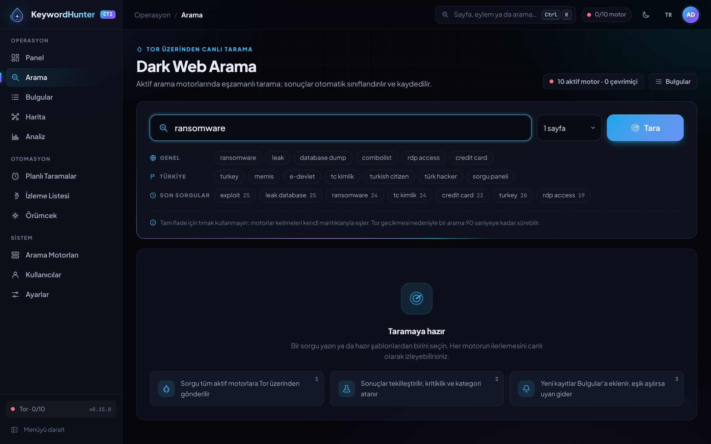 **Arama** — eşzamanlı motor taraması |
| 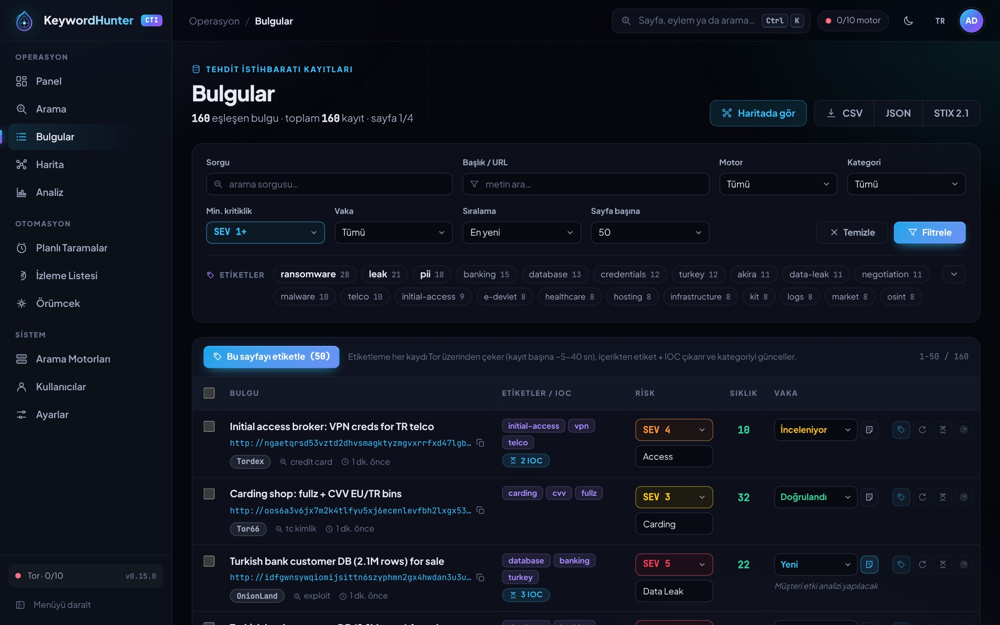 **Bulgular** — filtre, vaka yönetimi, toplu işlem | 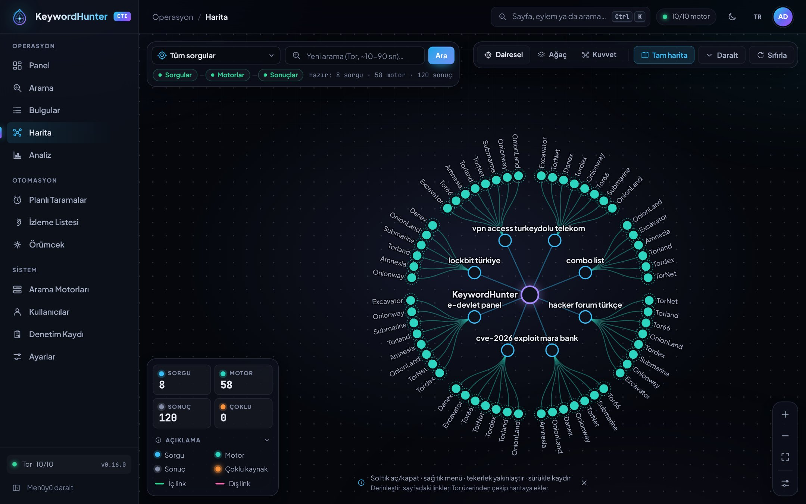 **Harita** — ilişki grafiği ve derinleştirme |
| 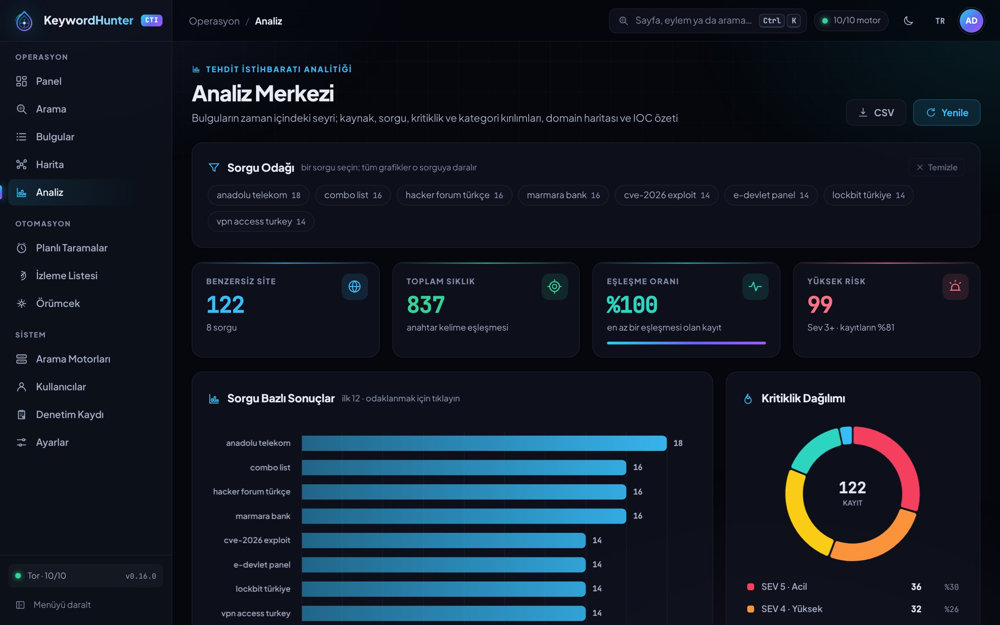 **Analiz** — tema duyarlı grafikler | 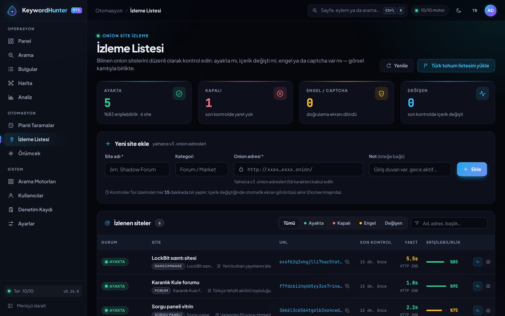 **İzleme Listesi** — uptime, değişiklik, captcha |
| 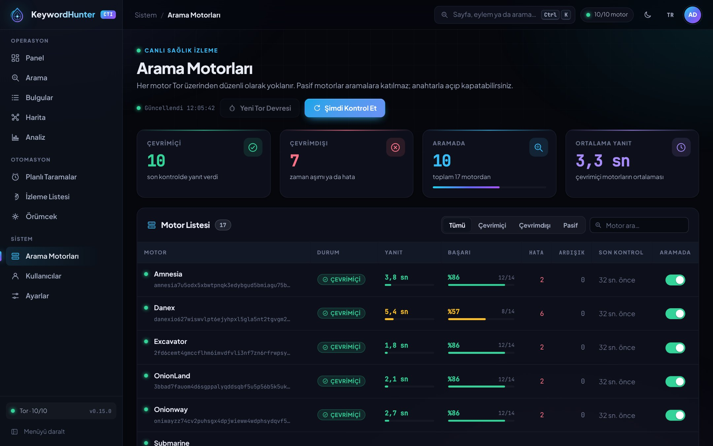 **Motorlar** — canlı sağlık ve aç/kapat | 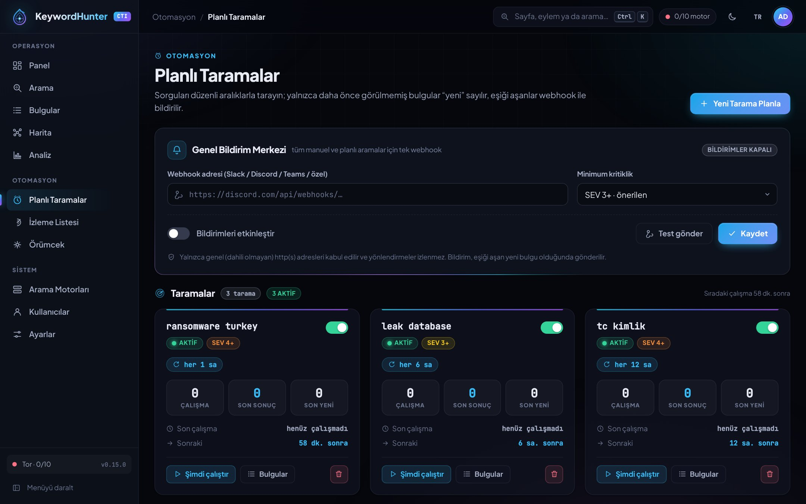 **Planlı Taramalar** — webhook bildirim merkezi |
| 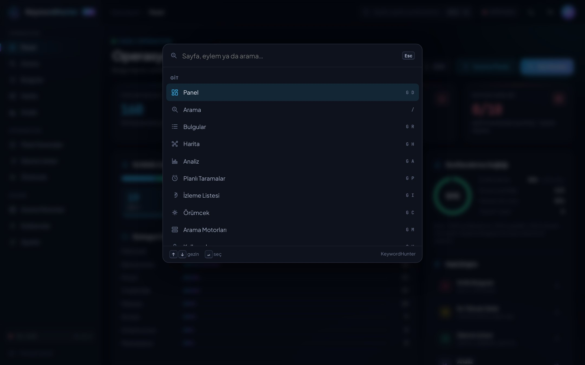 **Komut paleti** — <kbd>Ctrl</kbd>+<kbd>K</kbd> |  **Açık tema** — tek tıkla ya da sistemle uyumlu |

<p align="center">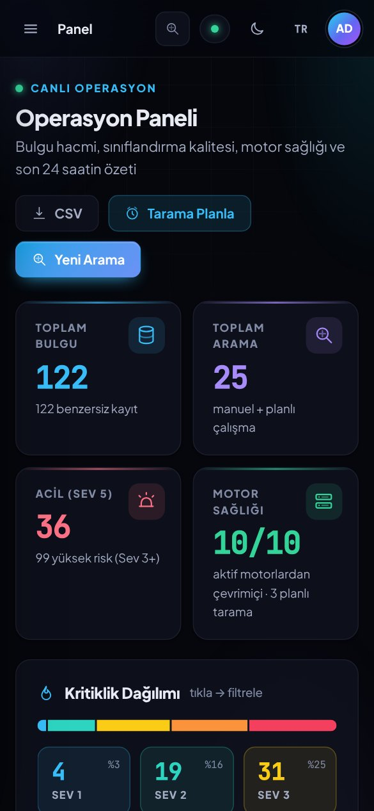</p>

## ⚙️ Yapılandırma (`.env` / `data/.env`)

| Değişken | Varsayılan | Açıklama |
|---|---|---|
| `ADMIN_USER` | `admin` | Giriş kullanıcı adı |
| `ADMIN_PASS` | — | Düz metin parola. /settings'ten değiştirildiğinde silinir ve `ADMIN_PASS_HASH` yazılır |
| `ADMIN_PASS_HASH` | — | bcrypt hash; verilirse `ADMIN_PASS` gerekmez |
| `WEB_ADDR` | `:8080` | Dinleme adresi |
| `WEB_SECURE_COOKIES` | `false` | HTTPS arkasında `true`. Düz HTTP'de `true` ise tarayıcı çerezi reddeder |
| `SESSION_TTL_HOURS` | `24` | Kayan oturum süresi (1–720); mutlak üst sınır 30 gün |
| `RATE_LIMIT_RPS` / `RATE_LIMIT_BURST` | `25` / `80` | IP başına hız limiti (statik dosyalar muaf) |
| `TOR_PROXY` | `127.0.0.1:9150` | SOCKS5 adresi; Docker'da otomatik `tor:9050` |
| `TOR_CONTROL` / `TOR_CONTROL_PASSWORD` | — | Devre yenileme (NEWNYM) için kontrol portu |
| `DB_PATH` | `keywordhunter.db` | SQLite dosyası |
| `LOG_DIR` / `LOG_LEVEL` | `logs` / `info` | Döndürmeli log |
| `APP_SECRET` | otomatik | Uygulama ana sırrı (64 hex = 32 bayt, ör. `openssl rand -hex 32`). 2FA (TOTP) sırları bundan türetilen anahtarla **AES-256-GCM** ile şifreli saklanır. Yoksa ilk açılışta üretilip etkin `.env`'e yazılır (değer loglanmaz). **Yedekleyin:** kaybolur ya da değişirse kayıtlı 2FA sırları çözülemez; kullanıcılar kurtarma kodlarıyla girebilir, adminin `/users` ekranından 2FA'larını sıfırlaması gerekir |
| `REQUIRE_2FA` | `none` | İki adımlı doğrulama zorunluluğu: `none` · `admins` (yalnız admin rolü) · `all`. Kayıtsız kullanıcı yalnız **Hesabım**'daki 2FA kurulumuna erişir; API token'ları 403 alır. Etkinken `users` dışı `.env` yönetici girişi reddedilir ve kalıcı `APP_SECRET` şarttır |
| `AUDIT_RETENTION_DAYS` | `365` | Denetim kaydı (hash zincirli) saklama süresi, gün (`0` = süresiz). Budamada zincir bir çapayla doğrulanabilir kalır |
| `WATCHLIST_INTERVAL_MIN` | `15` | İzleme kontrol aralığı |
| `WATCHLIST_SEED` | `none` | `turkey` = gömülü Türk onion listesi; dosya yolu = JSON seed |
| `SCREENSHOT_DIR` | `/data/screenshots` (Docker) / `screenshots` | PNG çıktı dizini |
| `CHROME_BIN` | otomatik | Chrome/Chromium yolu |
| `WEBHOOK_ALLOW_PRIVATE` | `false` | `true` ise webhook'lar kurum içi (10.x, 192.168.x, localhost) SIEM/SOAR alıcılarına da gidebilir |
| `TZ` (compose) | `Europe/Istanbul` | Arayüzde gösterilen saat dilimi |

Docker'da `ENV_FILE=/data/.env` kullanılır; kökteki `.env` Docker için okunmaz.

## 🛡️ Güvenlik Modeli

Bu araç saldırgan içerik barındıran siteleri ziyaret eder ve oradan gelen metni gösterir; arayüz buna göre **güvenilmez girdi** varsayımıyla tasarlanmıştır.

- **Sıkı CSP:** `script-src 'self'` — şablonlarda tek satır satır içi betik veya `on*=` işleyici yoktur; bu, her şablon ve JS dosyası için **otomatik testle** zorlanır ([`templates_csp_test.go`](pkg/web/templates_csp_test.go)). Dark web'den gelen bir metin bir şekilde HTML'e sızsa bile tarayıcı onu çalıştırmaz.
- Ayrıca: `object-src 'none'`, `frame-ancestors 'none'`, `base-uri`/`form-action 'self'`, `X-Frame-Options: DENY`, `nosniff`, `Referrer-Policy: no-referrer`, COOP/CORP, HSTS (HTTPS'te).
- **Kimlik:** bcrypt, IP başına ve global login kilitleme (üstel), kayan + mutlak oturum ömrü, parola değişince diğer oturumlar düşer, rol değişikliği anında etkin.
- **İki adımlı doğrulama (TOTP, RFC 6238):** Google/Microsoft Authenticator, Authy, 1Password, Aegis… ile uyumlu; sırlar `APP_SECRET`'tan türetilen anahtarla AES-256-GCM şifreli, kurtarma kodları yalnız SHA-256 özetiyle saklanır; aynı kod iki kez kabul edilmez; isteğe bağlı zorunluluk (`REQUIRE_2FA`). Ayrıntılar: [İki adımlı doğrulama](#2fa).
- **RBAC:** admin / analist / izleyici; tüm yazma uçları analist+, yönetim uçları admin. Menü ve kontroller sunucu tarafında role göre süzülür.
- **CSRF:** tüm yazma uçlarında token (arama formu dahil); `GET /logout` Fetch Metadata ile korunur.
- **API token'ları:** `kh_` + 256 bit rastgele değer, yalnız SHA-256 özeti saklanır, bir kez gösterilir; okuma/yazma kapsamı sahibinin güncel rolünü aşamaz; hesap/güvenlik yönetimi uçları token'a kapalıdır (bkz. [API](#-api)).
- **SSRF:** derinleştirme / analiz / izleme / render yalnızca `.onion`; webhook ve ekran görüntüsü hedefleri DNS sonrası iç adreslere çözümlenemez, yönlendirme takip edilmez.
- **Sızıntı önleme:** webhook sırları log, API ve HTML'de maskelenir; CSV export formül enjeksiyonuna karşı korumalı.
- **Denetim kaydı:** giriş/çıkış, reddedilen erişimler, kullanıcı ve ayar değişiklikleri, silme, dışa aktarma gibi tüm durum değiştiren işlemler "kim, ne zaman, nereden, ne yaptı" olarak SHA-256 **hash zincirli**, yalnız eklenebilir bir tabloya yazılır; tek bir satırın değiştirilmesi, silinmesi ya da sondan kırpılması `/audit` ekranında (yalnız admin) kırılma noktasıyla gösterilir. Ayrıntılarda parola, çerez, token ve webhook yolu asla tutulmaz; `AUDIT_RETENTION_DAYS` ile budanır (zincir çapayla doğrulanabilir kalır), CSV/JSON dışa aktarılabilir.
- **Tedarik zinciri:** tüm varlıklar gömülü (CDN yok), her push'ta `govulncheck`, Dependabot, sürümlerde SHA256 özetleri.
- **Docker:** root olmayan kullanıcı, `no-new-privileges`, Tor portu host'a kapalı.

Zafiyet bildirimi için [SECURITY.md](SECURITY.md).

## 🧭 Mimari

```mermaid
flowchart LR
    subgraph Browser["Tarayıcı (CSP: script-src 'self')"]
      UI["Nightwatch UI<br/>kh.css · app.js · pages/*.js"]
    end
    subgraph Binary["keywordhunter (tek Go ikilisi)"]
      WEB["pkg/web<br/>Gin · html/template · RBAC · CSRF · SSE"]
      SRCH["pkg/search<br/>motorlar + parser"]
      SCR["pkg/scraper · pkg/tagging<br/>metin · etiket · IOC"]
      CTI["pkg/cti · pkg/artifact<br/>sınıflandırma · IOC"]
      BG["pkg/scheduler · pkg/monitor<br/>pkg/crawler · pkg/capture"]
      NTF["pkg/notify<br/>webhook"]
      DB[("SQLite<br/>pkg/storage")]
    end
    TOR(["Tor SOCKS5"]) --> ONION(["Onion arama motorları<br/>ve hedef siteler"])
    UI <-->|"HTTPS / SSE"| WEB
    WEB --> SRCH & SCR & BG
    SRCH & SCR & BG --> TOR
    SCR --> CTI
    WEB & SRCH & SCR & BG --> DB
    BG --> NTF -->|"Slack · Discord · Teams · SIEM"| EXT(["Webhook alıcıları"])
```

Ön yüz sözleşmesi (bileşenler, olay delegasyonu, tema, i18n): [docs/FRONTEND.md](docs/FRONTEND.md).

## 🔌 API

Tarayıcı oturumuyla (çerez + `X-CSRF-Token`) ya da **kişisel API token'ı** ile çağrılır. Uç noktalar:

`GET /api/results?q=&text=&source=&category=&minCriticality=&tag=&sort=&limit=&page=` ·
`GET /api/export/results?format=csv|json` · `GET /api/export/stix` · `POST /api/results/delete` ·
`POST /api/results/:id/case` · `POST /api/auto-tag` · `POST /api/batch-auto-tag` ·
`GET /api/results/:id/artifacts` · `GET /api/artifacts?type=&value=` · `GET /api/artifacts/stats` ·
`GET /api/engines` · `POST /api/engines/:name/toggle` · `GET|POST /api/scheduled` ·
`POST /api/scheduled/:id/run-now` · `GET|POST /api/alert-config` · `POST /api/alert-config/test` ·
`GET|POST /api/watchlist` · `POST /api/watchlist/:id/check` · `POST /api/screenshot` ·
`GET /api/screenshots` · `GET /api/analytics` · `GET /api/graph/*` · `GET /events` (SSE) ·
`GET /healthz` (açık).

### Kişisel API token'ları (SOAR / SIEM / betikler)

Token'ı **Hesabım → API token'ları** (`/account`) ekranından oluşturun. Değer (`kh_…`) **yalnızca bir kez** gösterilir; sunucuda yalnızca SHA-256 özeti saklanır. Her isteğin `Authorization` başlığında gönderin:

```bash
export KH_TOKEN='kh_…'   # parola kasasından / gizli değişkenden okuyun
# Okuma: son kritik bulgular
curl -sS -H "Authorization: Bearer $KH_TOKEN" \
  'https://keywordhunter.example/api/results?minCriticality=4&limit=20'
# Yazma ("write" kapsamı): çerez yoksa CSRF başlığı gerekmez
curl -sS -X POST -H "Authorization: Bearer $KH_TOKEN" -H 'Content-Type: application/json' \
  -d '{"status":"investigating","note":"SOAR: triage açıldı"}' 'https://keywordhunter.example/api/results/42/case'
# Token'ın kimliğini ve etkin rolünü sına
curl -sS -H "Authorization: Bearer $KH_TOKEN" https://keywordhunter.example/api/whoami
```

- **Kapsam:** `read` izleyici (viewer) yetkisine indirgenir, hiçbir yazma işlemi yapamaz; `write` sahibinin **güncel** rolü kadar yetkilidir (rol düşürülürse token da anında düşer). İzleyiciler yalnız `read` token oluşturabilir.
- **Geçerlilik:** 7 / 30 / 90 / 180 / 365 gün ya da süresiz; dilediğiniz an iptal edilir. İptal edilmiş, süresi dolmuş, bilinmeyen token ya da pasif/silinmiş kullanıcı → `401 {"error": …}` + `WWW-Authenticate: Bearer`.
- **Yalnız `/api/` ve yalnız başlık:** HTML sayfaları, `/events` (SSE) ve ekran görüntüsü dosyaları token kabul etmez; `?token=` gibi sorgu dizgisi değerleri asla okunmaz.
- **CSRF kuralı:** yalnız Bearer ile gelen (oturum çerezi taşımayan) istekler CSRF'ten muaftır. Aynı istekte oturum çerezi de varsa oturum yolu kullanılır ve CSRF zorunludur.
- **Token ile çağrılamayan uçlar** (`403 "this endpoint requires an interactive session"`): `/api/tokens*` (token yönetimi), `/api/me/*` (parola, 2FA), `/api/users*`, `/api/settings/*`, `/api/site-profiles*`, `/api/alert-config*` (webhook entegrasyonları). Sızmış bir token yeni token basamaz, parola değiştiremez, hesap ya da entegrasyon yönetemez.
- **Parola değişikliği ve olay müdahalesi:** admin bir kullanıcının parolasını sıfırladığında o kullanıcının oturumları kapanır **ve tüm API token'ları iptal edilir** (`user.password.reset` olayında `tokensRevoked`). Kullanıcının kendi parola değişikliği token'ları varsayılan olarak iptal etmez (entegrasyonlar bozulmasın); ele geçirme şüphesinde **Hesabım → Parola** altındaki "Tüm API token'larımı da iptal et" seçeneğini işaretleyin (`POST /api/me/password` gövdesinde `"revokeTokens": true`). Kullanıcıyı pasifleştirmek de token'larını anında geçersiz kılar.
- **Denetim:** token oluşturma/iptal (`token.create`, `token.revoke`), reddedilen token denemeleri (`auth.token.failure`) ve token ile yapılan **denetlenen her işlem** (yazmalar, dışa aktarmalar, yetki retleri) `auth_method=token` ve token öneki (`kh_XXXXXXX`) ile denetim kaydına yazılır. Salt okuma istekleri (ör. `GET /api/results`) ayrı denetim satırı üretmez; yalnız token'ın son kullanım zamanı ve IP'si (en fazla dakikada bir) güncellenir ve listede görünür.

<a id="2fa"></a>

## 🔐 İki adımlı doğrulama (2FA)

**Hesabım → İki adımlı doğrulama** (`/account#security-2fa`) altından etkinleştirilir: QR kodu (ya da 4'erli gruplanmış anahtarı) kimlik doğrulayıcı uygulamasına ekleyin, 6 haneli kodu mevcut parolanızla birlikte doğrulayın ve gösterilen **10 kurtarma kodunu** (`xxxx-xxxx`, her biri tek kullanımlık, yalnız bir kez gösterilir; kopyala / `.txt` indir) saklayın.

- **Giriş:** parola doğruysa oturum **açılmaz**; 5 dakikalık, sunucu tarafında tutulan bir "bekleyen giriş" oluşur (yalnız `/login` yoluna kapsamlı, `HttpOnly` + `SameSite=Strict` çerez) ve `/login/2fa` ekranı açılır. 6 hane girilince kod otomatik gönderilir; "Kurtarma kodu kullan" ile kurtarma koduna geçilir. 5 hatalı kodda bekleyen giriş geçersiz olur; kod hataları IP giriş kilidine de sayılır (parolayla yeniden başlamak kilidi aşamaz). Deneme hakları doğrulamadan önce atomik olarak ayrılır: eşzamanlı istekler 5 deneme sınırını aşamaz. Parolanızı değiştirmek, eski parolayla başlatılmış bekleyen girişi de düşürür. Giriş sayfası parola doğrulanmadan 2FA'nın varlığını belli etmez.
- **TOTP:** HMAC-SHA1, 6 hane, 30 sn, ±1 adım saat kayması toleransı, sabit-zamanlı karşılaştırma. Kabul edilen son adım kalıcı tutulur: aynı kod (ya da daha eski bir adımın kodu) ikinci kez kabul edilmez.
- **Kapatma / kod yenileme:** parola + güncel kod (ya da bir kurtarma kodu) ister; hatalı denemeler IP kilidine sayılır. Kod yenileme eski kodların tümünü geçersiz kılar. **Etkinleştirme de mevcut parolayı ister** (çalınmış bir oturum kendi doğrulayıcısını kaydedip hesabın sahibini dışarıda bırakamaz); 2FA'yı açmak diğer oturumlarınızı kapatır.
- **Admin sıfırlaması** (`/users` → kalkan simgesi, `POST /api/users/:id/2fa/reset`): cihazını kaybeden bir kullanıcının 2FA kaydını ve kurtarma kodlarını siler, oturumlarını kapatır. Admin **kendi** 2FA'sını bu uçla sıfırlayamaz (Hesabım'dan parola + kodla kapatır): ele geçirilmiş bir admin oturumu kendi ikinci faktörünü yeniden doğrulamadan kaldıramasın.
- **Zorunluluk (`REQUIRE_2FA=admins|all`):** kapsamdaki kayıtsız kullanıcının her HTML sayfası `/account#security-2fa`'ya yönlenir (uyarıyla); oturumlu API çağrıları kayıt uçları dışında `403 {"error": "2FA required"}` alır; bu kullanıcının API token'ları da 403 ile reddedilir. `users` tablosunda olmayan eski `.env` yönetici hesabı (`ADMIN_USER`, ör. ad `/settings`'ten değiştirildiyse ya da bootstrap satırı silindiyse) 2FA kaydı yapamayacağı için politika etkinken **giriş yapamaz** ve var olan oturumu kapatılır; `/users`'taki bir hesabı kullanın. Kalıcı bir `APP_SECRET` yoksa (`.env` yazılamıyor) `REQUIRE_2FA` ile uygulama **başlamaz**: aksi halde kayıt kapalı olduğundan kapsamdaki herkes Hesabım'a hapsolurdu.
- **`APP_SECRET`:** sırlar bu anahtardan HKDF-SHA256 ile türetilen AES-256-GCM anahtarıyla, kullanıcıya bağlı (AAD) şifrelenir. Kaybolursa TOTP kodları doğrulanamaz: kullanıcılar kurtarma kodlarıyla girip 2FA'yı kapatıp yeniden kurabilir; kodu olmayanlar için admin sıfırlaması gerekir. Üretilen sır `.env`'in sonuna tek satır olarak eklenir; dosyadaki yorumlar ve diğer satırlar korunur. `.env` yazılamıyorsa sır o çalıştırmayla sınırlı kalır ve 2FA kaydı kapatılır (loga yazılır).
- **Uçlar** (yalnız etkileşimli oturum; API token ile çağrılamaz): `GET /api/me/2fa` · `POST /api/me/2fa/setup` → `{qrDataURI, secret, otpauthURI}` · `POST /api/me/2fa/enable {password, code}` → `{recoveryCodes}` · `POST /api/me/2fa/disable {password, code}` · `POST /api/me/2fa/recovery-codes {password, code}` · `POST /api/users/:id/2fa/reset` (admin).
- **Denetim:** `2fa.enable`, `2fa.disable`, `2fa.recovery.regenerate`, `2fa.reset_by_admin`, `auth.2fa.challenge`, `auth.2fa.success`, `auth.2fa.failure` (neden: `bad_code`, `replay`…); `auth.login.success` olayı `mfa` yöntemini taşır. Sır ya da kod asla kayda girmez.

## 🧑‍💻 Geliştirme

```bash
go build ./... && go vet ./... && go test -race ./...
```

Test kapsamı: yapılandırma/env deposu, kimlik + kilitleme, auth/CSRF/logout, RBAC, **CSP regresyonu**,
arama parser'ı, CTI sınıflandırıcı (TR/EN/RU/DE/ES/PT + yanlış pozitif korumaları), artifact çıkarımı, STIX, storage migrasyonları,
SSRF korumaları, webhook sırrı maskeleme, crawler, scraper, tagging.

Katkı için [CONTRIBUTING.md](CONTRIBUTING.md) · Davranış kuralları [CODE_OF_CONDUCT.md](CODE_OF_CONDUCT.md) · Sürüm notları [CHANGELOG.md](CHANGELOG.md).

## ⚖️ Yasal Uyarı

Bu yazılım güvenlik araştırmacıları ve SOC/CTI ekipleri içindir. Yalnızca **izole bir ortamda**
ve **yasal yetkiniz dahilinde** kullanın. Yetkisiz erişim veya yasa dışı faaliyet için
kullanılamaz; sorumluluk kullanıcıya aittir.

<div align="center">

**Geliştirici:** [Mehmet Yasin Uzun](https://github.com/mehmetyasinuzun) · MIT Lisansı


</div>
