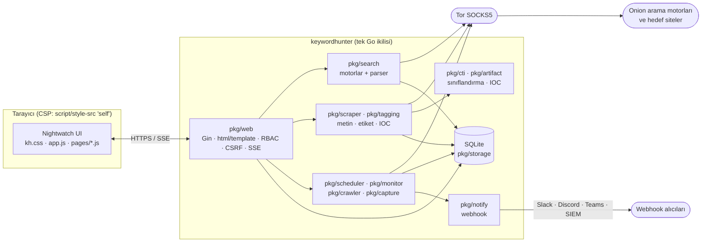

<div align="center">

<picture>
  <source media="(prefers-color-scheme: light)" srcset="docs/assets/banner-light.svg">
  
</picture>

[](https://github.com/mehmetyasinuzun/Keyword-Hunter/actions/workflows/ci.yml)
[](https://github.com/mehmetyasinuzun/Keyword-Hunter/releases)
[](go.mod)
[](LICENSE)
[](https://github.com/mehmetyasinuzun/Keyword-Hunter/pkgs/container/keyword-hunter)
[](docs/FRONTEND.md)


**Tor ağındaki onion arama motorlarını eşzamanlı tarayan, bulguları otomatik sınıflandıran,
IOC çıkaran, siteleri izleyen ve yeni tehditleri anında bildiren — tek ikili dosyadan oluşan
CTI platformu.**

[Özellikler](#-özellikler) · [Hızlı Başlangıç](#-hızlı-başlangıç) · [Motorlar](#️-arama-motorları) · [Ekran Görüntüleri](#️-ekran-görüntüleri) · [Mimari](#-mimari) · [Güvenlik](#️-güvenlik-modeli) · [**English**](README.en.md)

</div>

---

<p align="center">
  
  
</p>

## 🎯 Neden KeywordHunter?

- **Tek konsol, tüm akış:** ara → sınıflandır → IOC çıkar → izle → bildir → STIX ile dışa aktar.
- **Tor-only, yerel-öncelikli:** tüm dış trafik Tor üzerinden çıkar; veri yalnızca sizin SQLite dosyanızda. CDN yok, telemetri yok.
- **Tek ikili, sıfır bağımlılık:** saf Go (CGO yok), altı platform, Docker imajı hazır.
- **Ekip için tasarlandı:** admin / analist / izleyici rolleri, vaka durumu ve analist notları, planlı taramalar, webhook (Slack / Discord / Teams / SIEM), SOAR/SIEM otomasyonu için kişisel API token'ları.
- **Analist deneyimi:** komut paleti (<kbd>Ctrl</kbd>+<kbd>K</kbd>), klavye kısayolları, açık/koyu/sistem teması, Türkçe + İngilizce arayüz, mobil uyumlu.

## ✨ Özellikler

| Modül | Yetenekler |
|---|---|
| 🔎 **Arama** | 10 canlı doğrulanmış onion motorunda paralel tarama, motor bazında canlı ilerleme (SSE), sayfalama, otomatik kritiklik (1-5) ve kategori (TR · EN · RU · DE · ES · PT sinyaller; aksan/büyük-küçük harf duyarsız, kelime sınırlı kök eşleşmesi), tekilleştirme |
| 🗂️ **Bulgular** | Çok boyutlu filtre (sorgu, metin, motor, kategori, min. kritiklik, etiket, vaka), sıralama, toplu işlemler (etiketle / kritiklik / kopyala / sil), satır içi düzenleme, **vaka yönetimi** (yeni → inceleniyor → doğrulandı / elendi + not), CSV · JSON · **STIX 2.1** |
| 🧬 **Etiketleme + IOC** | Sayfayı Tor'dan çeker; Unicode/Türkçe duyarlı anahtar kelime çıkarımı; e-posta, BTC/XMR, IP, hash, kart (Luhn), SSH/API anahtarı, onion IOC'leri; pivot arama |
| 🕸️ **Harita** | Sorgu → motor → sonuç ilişki grafiği (radial / tree / force), düğüm derinleştirme (sayfadaki linkleri grafa ekler), odaklan, izlemeye ekle |
| 📈 **Analiz** | Zaman serisi, kaynak / sorgu / kritiklik / kategori dağılımları, domain haritası, tema duyarlı grafikler |
| ⏱️ **Planlı Tarama** | Dakika bazlı periyot, yalnızca *yeni* URL diff'i, tarama-özel ve genel webhook, eşik, test gönderimi |
| 📡 **İzleme Listesi** | Onion siteleri için uptime %, görünür-metin hash'i ile değişiklik tespiti, Cloudflare/captcha sezimi, tetiklenen ve manuel ekran görüntüsü, zaman çizelgesi |
| 🛰️ **Motorlar** | Canlı sağlık, yanıt süresi, başarı oranı, aç/kapat (aramayı gerçekten etkiler), tüm motorlar düşerse otomatik Tor devre yenileme (NEWNYM) |
| 🕷️ **Örümcek** | Tohum .onion'dan derinlik/sayfa sınırlı, nazik BFS site taraması; keşfedilen sayfalar bulgu olur |
| 🍪 **Site Profilleri** | Host bazlı Cookie + User-Agent + JS render (giriş duvarı / captcha arkası) |
| 👥 **Ekip** | Çok kullanıcılı, rol tabanlı erişim (admin / analist / izleyici), parola sıfırlama, oturum iptali, SOAR/SIEM için kişisel **API token'ları** (okuma/yazma kapsamı, süre sonu, iptal) |
| 🧾 **Denetim Kaydı** | Kim, ne zaman, nereden, ne yaptı: giriş, rol, vaka, ayar, token ve dışa aktarma olayları; **SHA-256 hash zinciri** ile kurcalanma tespiti, tek tıkla zincir doğrulama, filtre, CSV/JSON dışa aktarma, saklama süresi (`AUDIT_RETENTION_DAYS`) |
| 🔐 **İki Adımlı Doğrulama** | RFC 6238 TOTP (QR + manuel anahtar), tek kullanımlık kurtarma kodları, `REQUIRE_2FA=admins\|all` ile zorunlu kılma, sırlar `APP_SECRET`'tan türetilen anahtarla AES-256-GCM şifreli, admin tarafından sıfırlama |
| 🔗 **Entegrasyonlar** | OpenCTI / Microsoft Sentinel için salt okunur **TAXII 2.1 sunucusu** (sabit koleksiyonlar, kararlı STIX nesneleri, token ile Basic/Bearer); seçili bulguları tek **MISP olayı** olarak gönderme (şifreli anahtar, SSRF korumalı, isteğe bağlı otomatik gönderim) — [docs/INTEGRATIONS.md](docs/INTEGRATIONS.md) |

### Arayüz

- **Nightwatch tasarım sistemi** — tek kaynaklı token'lar, açık / koyu / sistem teması (ilk boyamada sunucu tarafında uygulanır, yanıp sönme yok).
- **Komut paleti** (<kbd>Ctrl</kbd>/<kbd>⌘</kbd>+<kbd>K</kbd>): sayfalara git, dark web'de ara, bulgularda filtrele, tema/dil değiştir.
- **Klavye öncelikli:** <kbd>/</kbd> arama · <kbd>G</kbd> sonra <kbd>D</kbd>/<kbd>R</kbd>/<kbd>H</kbd>/<kbd>A</kbd>/<kbd>P</kbd>/<kbd>I</kbd>/<kbd>C</kbd>/<kbd>M</kbd> sayfalar · <kbd>?</kbd> yardım.
- Akıcı mikro-etkileşimler: sayfalar arası görünüm geçişleri, kademeli giriş, sayaç animasyonları, imleç takipli ışık, iskelet yükleyiciler — `prefers-reduced-motion` tam desteklenir.
- Erişilebilirlik: anlamsal işaretleme, odak tuzaklı modallar, klavyeyle tam gezinme, "içeriğe geç" bağlantısı.

## 🚀 Hızlı Başlangıç

### Docker (önerilen)

```bash
git clone https://github.com/mehmetyasinuzun/Keyword-Hunter.git
cd Keyword-Hunter
docker compose up -d --build
docker compose logs app | grep -A3 "yönetici parolası"   # ilk kurulumda üretilen parola
```

Arayüz: **http://localhost:8080** · Sağlık: `http://localhost:8080/healthz`

Hazır imaj (etiketli sürümlerde GHCR'a yayınlanır):

```bash
docker pull ghcr.io/mehmetyasinuzun/keyword-hunter:latest
```

- Varsayılan olarak yalnızca bu makineden erişilir; Tor konteyneri host'a port yayınlamaz.
- LAN/sunucudan erişim: `KH_BIND=0.0.0.0 docker compose up -d` — mutlaka güçlü parola, HTTPS ters vekil (Caddy/nginx) ve `WEB_SECURE_COOKIES=true`.
- Kalıcı veri `./data/` altında: `keywordhunter.db`, `.env`, `logs/`, `screenshots/`. `docker compose down -v && rm -rf data` tümünü siler.
- v0.17.0'dan itibaren yeni log dosyaları ve ekran görüntüleri yalnız sahibine açıktır (`0600`; Docker'da sahibi uid 10001 `kh`): host'ta `tail data/logs/…` izin hatası verir. Logları `docker compose logs app` (konsola da yazılır) ya da `sudo` ile okuyun; host'ta çalışan bir log toplayıcıyı uid 10001 ile ya da konteyner içinde çalıştırın. Eski dosyaların izinleri değişmez.
- Windows: `temiz_baslat.bat` aynı adımları yapar.

### Yerel (macOS / Linux / Windows, Go 1.27+)

| Platform | Başlat | Not |
|---|---|---|
| macOS / Linux | `./run.sh` (veya `make run`) | `.env` yoksa şablondan oluşturur, Tor portunu kontrol eder |
| Windows (PowerShell) | `.\run.ps1` | `winget install GoLang.Go` ile Go kurun |
| Windows (cmd) | `build_and_run.bat` | `run.ps1`'i çağıran ince sarmalayıcı |
| Her platform | `./run.sh release` | `dist/` altına 6 platform için ikili üretir |

Tor: **Tor Browser** 9150, **tor servisi** 9050 portunu dinler (`brew install tor`, `apt install tor`, Windows'ta Tor Expert Bundle). `.env` içindeki `TOR_PROXY` bunu göstermeli.
Ekran görüntüsü için Chrome/Chromium/Brave/Edge otomatik bulunur; bulunamazsa `CHROME_BIN=/yol/chrome`. Docker imajında Chromium hazır gelir.

## 🛰️ Arama Motorları

Liste 2026-09-18'de gerçek Tor devresi üzerinden, üç turda ve iki sorguyla doğrulandı
([`pkg/search/engines.go`](pkg/search/engines.go)). Varsayılan aktif: **Tordex, Amnesia, Tor66,
Onionway, OnionLand, Torland, Excavator, TorNet, Submarine, Danex**. Captcha isteyen (OSS, Torgle),
JavaScript gerektiren (Torgol), boş dizinli (DeepSearches) veya erişilemeyen (Torch, Ahmia onion,
FindTor) motorlar pasif gelir ve **Arama Motorları** ekranından açılabilir. Motor listesi
değiştiğinde kullanıcı özelleştirmeleri korunur.

## 🖼️ Ekran Görüntüleri

| | |
|---|---|
|  **Giriş** — canlı radar, kilitleme geri sayımı |  **Arama** — eşzamanlı motor taraması |
|  **Bulgular** — filtre, vaka yönetimi, toplu işlem |  **Harita** — ilişki grafiği ve derinleştirme |
|  **Analiz** — tema duyarlı grafikler |  **İzleme Listesi** — uptime, değişiklik, captcha |
|  **Motorlar** — canlı sağlık ve aç/kapat |  **Planlı Taramalar** — webhook bildirim merkezi |
|  **Denetim Kaydı** — hash zinciri doğrulama |  **Hesabım** — 2FA ve API token'ları |
|  **Entegrasyonlar** — MISP ve TAXII 2.1 |  **Koyu tema** — Nightwatch tasarım sistemi |
|  **Komut paleti** — <kbd>Ctrl</kbd>+<kbd>K</kbd> |  **Açık tema** — tek tıkla ya da sistemle uyumlu |

<p align="center"></p>

## ⚙️ Yapılandırma (`.env` / `data/.env`)

| Değişken | Varsayılan | Açıklama |
|---|---|---|
| `ADMIN_USER` | `admin` | Giriş kullanıcı adı |
| `ADMIN_PASS` | — | Düz metin parola. /settings'ten değiştirildiğinde silinir ve `ADMIN_PASS_HASH` yazılır |
| `ADMIN_PASS_HASH` | — | bcrypt hash; verilirse `ADMIN_PASS` gerekmez |
| `WEB_ADDR` | `:8080` | Dinleme adresi |
| `WEB_SECURE_COOKIES` | `false` | HTTPS arkasında `true`. Düz HTTP'de `true` ise tarayıcı çerezi reddeder |
| `SESSION_TTL_HOURS` | `24` | Kayan oturum süresi (1–720); mutlak üst sınır 30 gün |
| `RATE_LIMIT_RPS` / `RATE_LIMIT_BURST` | `25` / `80` | IP başına hız limiti (statik dosyalar muaf) |
| `TOR_PROXY` | `127.0.0.1:9150` | SOCKS5 adresi; Docker'da otomatik `tor:9050` |
| `TOR_CONTROL` / `TOR_CONTROL_PASSWORD` | — | Devre yenileme (NEWNYM) için kontrol portu |
| `DB_PATH` | `keywordhunter.db` | SQLite dosyası |
| `LOG_DIR` / `LOG_LEVEL` | `logs` / `info` | Döndürmeli log |
| `APP_SECRET` | otomatik | Uygulama ana sırrı (64 hex = 32 bayt, ör. `openssl rand -hex 32`). 2FA (TOTP) sırları bundan türetilen anahtarla **AES-256-GCM** ile şifreli saklanır. Yoksa ilk açılışta üretilip etkin `.env`'e yazılır (değer loglanmaz). **Yedekleyin:** kaybolur ya da değişirse kayıtlı 2FA sırları çözülemez; kullanıcılar kurtarma kodlarıyla girebilir, adminin `/users` ekranından 2FA'larını sıfırlaması gerekir |
| `REQUIRE_2FA` | `none` | İki adımlı doğrulama zorunluluğu: `none` · `admins` (yalnız admin rolü) · `all`. Kayıtsız kullanıcı yalnız **Hesabım**'daki 2FA kurulumuna erişir; API token'ları 403 alır. Etkinken `users` dışı `.env` yönetici girişi reddedilir ve kalıcı `APP_SECRET` şarttır |
| `AUDIT_RETENTION_DAYS` | `365` | Denetim kaydı (hash zincirli) saklama süresi, gün (`0` = süresiz). Budamada zincir bir çapayla doğrulanabilir kalır |
| `BACKUP_DIR` | — (kapalı) | Zamanlanmış yedek dizini (Docker: `/data/backups`; giriş betiği şablondaki göreli `backups`'ı oraya taşır). Göreli yol çalışma dizinine göre çözülür; Ayarlar mutlak yolu gösterir. Boşsa zamanlanmış yedek kapalıdır; anlık indirme ve `keywordhunter backup` yine çalışır. Bkz. [Yedekleme](#-yedekleme-ve-geri-yükleme) |
| `BACKUP_INTERVAL_HOURS` | `24` | Zamanlanmış yedek aralığı, saat (1–8760) |
| `BACKUP_KEEP` | `7` | Dizinde tutulacak en yeni yedek sayısı (1–1000); eskiler silinir |
| `RESULT_RETENTION_DAYS` | `0` (süresiz) | Bulguların saklanacağı gün; bir aramanın bulguyu **son döndürdüğü** andan sayılır (hiç yeniden görülmediyse ilk görülmeden). Günde bir, bu süreden uzun süredir görülmeyen bulgular etiket, IOC, MISP kaydı, graf düğümü (derinleştirme alt ağacı dahil) ve ekran görüntüleriyle (dosya dahil) silinir; vaka durumu **İnceleniyor** ya da **Doğrulandı** olanlar tutulur. Bkz. [Saklama süresi](#️-saklama-süresi) |
| `SCREENSHOT_RETENTION_DAYS` | `0` (süresiz) | Ekran görüntülerinin (satır + PNG) saklanacağı gün; İnceleniyor/Doğrulandı bir vakanın URL'sine ait görüntüler (kanıt) tutulur |
| `WATCHLIST_INTERVAL_MIN` | `15` | İzleme kontrol aralığı |
| `WATCHLIST_SEED` | `none` | `turkey` = gömülü Türk onion listesi; dosya yolu = JSON seed |
| `SCREENSHOT_DIR` | `/data/screenshots` (Docker) / `screenshots` | PNG çıktı dizini |
| `CHROME_BIN` | otomatik | Chrome/Chromium yolu |
| `WEBHOOK_ALLOW_PRIVATE` | `false` | `true` ise webhook'lar kurum içi (10.x, 192.168.x, localhost) SIEM/SOAR alıcılarına da gidebilir |
| `TZ` (compose) | `Europe/Istanbul` | Arayüzde gösterilen saat dilimi |

Docker'da `ENV_FILE=/data/.env` kullanılır; kökteki `.env` Docker için okunmaz.

## 🛡️ Güvenlik Modeli

Bu araç saldırgan içerik barındıran siteleri ziyaret eder ve oradan gelen metni gösterir; arayüz buna göre **güvenilmez girdi** varsayımıyla tasarlanmıştır.

- **Sıkı CSP:** `script-src 'self'; style-src 'self'` — politikada hiçbir yerde `'unsafe-inline'` yoktur. Şablonlarda tek satır satır içi betik, `on*=` işleyici, `<style>` bloğu ya da `style=""` özniteliği yoktur (JS'nin ürettiği HTML dahil; dinamik değerler CSSOM ile atanır); bu, her şablon ve JS dosyası ile tüm sayfaların sunucu çıktısı için **otomatik testle** zorlanır ([`templates_csp_test.go`](pkg/web/templates_csp_test.go)). Dark web'den gelen bir metin bir şekilde HTML'e sızsa bile tarayıcı onu çalıştırmaz, satır içi CSS ile veri sızdıramaz ya da sahte arayüz bindiremez.
- Ayrıca: `object-src 'none'`, `frame-ancestors 'none'`, `base-uri`/`form-action 'self'`, `X-Frame-Options: DENY`, `nosniff`, `Referrer-Policy: no-referrer`, COOP/CORP, HSTS (HTTPS'te).
- **Kimlik:** bcrypt, IP başına ve global login kilitleme (üstel), kayan + mutlak oturum ömrü, parola değişince diğer oturumlar düşer, rol değişikliği anında etkin.
- **İki adımlı doğrulama (TOTP, RFC 6238):** Google/Microsoft Authenticator, Authy, 1Password, Aegis… ile uyumlu; sırlar `APP_SECRET`'tan türetilen anahtarla AES-256-GCM şifreli, kurtarma kodları yalnız SHA-256 özetiyle saklanır; aynı kod iki kez kabul edilmez; isteğe bağlı zorunluluk (`REQUIRE_2FA`). Ayrıntılar: [İki adımlı doğrulama](#2fa).
- **RBAC:** admin / analist / izleyici; tüm yazma uçları analist+, yönetim uçları admin. Menü ve kontroller sunucu tarafında role göre süzülür.
- **CSRF:** tüm yazma uçlarında token (arama formu dahil); `GET /logout` Fetch Metadata ile korunur.
- **API token'ları:** `kh_` + 256 bit rastgele değer, yalnız SHA-256 özeti saklanır, bir kez gösterilir; okuma/yazma kapsamı sahibinin güncel rolünü aşamaz; hesap/güvenlik yönetimi uçları token'a kapalıdır (bkz. [API](#-api)).
- **SSRF:** derinleştirme / analiz / izleme / render yalnızca `.onion`; webhook ve ekran görüntüsü hedefleri DNS sonrası iç adreslere çözümlenemez, yönlendirme takip edilmez.
- **Sızıntı önleme:** webhook sırları log, API ve HTML'de maskelenir; CSV export formül enjeksiyonuna karşı korumalı.
- **Entegrasyonlar:** MISP API anahtarı `APP_SECRET`'tan ayrı amaçla türetilen anahtarla AES-256-GCM şifreli saklanır, hiçbir yanıtta/sayfada/denetim kaydında görünmez ve adres başka sunucuya taşınırken yeniden istenir; MISP çıkışı Tor değil doğrudan clearnet/intranet'tir (yalnız genel hedef — "özel ağa izin ver" açılmadıkça —, yönlendirme yok, 1 MB / 15 sn). TAXII yalnız API token kabul eder (çerez yok, yazma yok); kart ve telefon numaraları ne TAXII'de ne MISP'te paylaşılır; düz http ile MISP yalnız kurum içi IP'lere. Ayrıntı: [docs/INTEGRATIONS.md](docs/INTEGRATIONS.md).
- **Denetim kaydı:** giriş/çıkış, reddedilen erişimler, kullanıcı ve ayar değişiklikleri, silme, dışa aktarma gibi tüm durum değiştiren işlemler "kim, ne zaman, nereden, ne yaptı" olarak SHA-256 **hash zincirli**, yalnız eklenebilir bir tabloya yazılır; tek bir satırın değiştirilmesi, silinmesi ya da sondan kırpılması `/audit` ekranında (yalnız admin) kırılma noktasıyla gösterilir. Ayrıntılarda parola, çerez, token ve webhook yolu asla tutulmaz; `AUDIT_RETENTION_DAYS` ile budanır (zincir çapayla doğrulanabilir kalır), CSV/JSON dışa aktarılabilir.
- **Tedarik zinciri:** tüm varlıklar gömülü (CDN yok); her push/PR'da `govulncheck`, `golangci-lint` (gosec dahil) ve CodeQL (Go, JavaScript, Actions; haftalık da); Dependabot. Sürümlerde SPDX SBOM (ikililer + imaj), cosign ile anahtarsız imzalı `SHA256SUMS.txt` ve özetle imzalı imaj, GitHub build provenance attestation'ları — bkz. [Sürümleri doğrulama](#-sürümleri-doğrulama).
- **Docker:** root olmayan kullanıcı, `no-new-privileges`, Tor portu host'a kapalı.

Zafiyet bildirimi için [SECURITY.md](SECURITY.md).

## ✅ Sürümleri doğrulama

Her sürüm GitHub Actions'taki [`release.yml`](.github/workflows/release.yml) tarafından üretilir ve depoda saklanan bir
anahtar olmadan, o workflow'un OIDC kimliğiyle ([Sigstore](https://www.sigstore.dev/) / Fulcio) imzalanır. Release
sayfasında ikililerin yanında şunlar bulunur:

| Dosya | İçerik |
|---|---|
| `SHA256SUMS.txt` | Tüm ikililerin ve ikili SBOM'unun SHA-256 özetleri |
| `SHA256SUMS.txt.sigstore.json` | `SHA256SUMS.txt`'nin cosign imza paketi (sertifika + şeffaflık kaydı) |
| `keywordhunter-<sürüm>.spdx.json` | İkililerin SPDX SBOM'u (gömülü Go modülleri ve araç zinciri) |
| `keywordhunter-<sürüm>-image.spdx.json` | Docker imajının (linux/amd64) SPDX SBOM'u — bilgi amaçlı kopya; `SHA256SUMS.txt` kapsamında değildir, imzalı hali imaj özetine bağlı SBOM attestation'ıdır (aşağıda) |

Gerekenler: [cosign](https://docs.sigstore.dev/cosign/system_config/installation/) v3+ (imzalar Sigstore paket biçimindedir) ve
[GitHub CLI](https://cli.github.com/) (`gh attestation`; GitHub API'sini kullandığı için önce `gh auth login` ya da `GH_TOKEN`).
`gh` olmadan da dosyaları Releases sayfasından indirip 2. ve 3. adımları ve imajın `cosign verify`'ını yapabilirsiniz.
Aşağıda `0.17.0` yerine doğruladığınız sürümü yazın.

```bash
# 1) Dosyaları indirin (ya da Releases sayfasından elle)
gh release download v0.17.0 --repo mehmetyasinuzun/Keyword-Hunter --dir kh-0.17.0 && cd kh-0.17.0

# 2) Özet listesinin imzası: yalnız bu deponun release workflow'u (v* tag'i ya da master'dan elle) imzalamış olmalı
cosign verify-blob \
  --bundle SHA256SUMS.txt.sigstore.json \
  --certificate-identity-regexp '^https://github\.com/mehmetyasinuzun/Keyword-Hunter/\.github/workflows/release\.yml@refs/(tags/v[0-9]+\.[0-9]+\.[0-9]+|heads/master)$' \
  --certificate-oidc-issuer https://token.actions.githubusercontent.com \
  SHA256SUMS.txt

# 3) Dosyalar imzalı listeyle eşleşmeli (tek ikili indirdiyseniz: --ignore-missing ekleyin)
sha256sum -c SHA256SUMS.txt

# 4) Build provenance: ikili bu deponun release workflow'unda (v* tag'i ya da master; GitHub'ın kendi runner'ı)
#    derlendi; kaynak commit çıktıdaki sourceRepositoryDigest'tir
gh attestation verify keywordhunter-0.17.0-linux-amd64 \
  --repo mehmetyasinuzun/Keyword-Hunter \
  --cert-identity-regex '^https://github\.com/mehmetyasinuzun/Keyword-Hunter/\.github/workflows/release\.yml@refs/(tags/v[0-9]+\.[0-9]+\.[0-9]+|heads/master)$' \
  --deny-self-hosted-runners
```

Docker imajı (etiket bir özete çözülür; en sıkısı `@sha256:…` ile özeti sabitlemektir):

```bash
cosign verify ghcr.io/mehmetyasinuzun/keyword-hunter:0.17.0 \
  --certificate-identity-regexp '^https://github\.com/mehmetyasinuzun/Keyword-Hunter/\.github/workflows/release\.yml@refs/(tags/v[0-9]+\.[0-9]+\.[0-9]+|heads/master)$' \
  --certificate-oidc-issuer https://token.actions.githubusercontent.com

# Provenance (imaj bu workflow'da derlendi)
gh attestation verify oci://ghcr.io/mehmetyasinuzun/keyword-hunter:0.17.0 \
  --repo mehmetyasinuzun/Keyword-Hunter \
  --cert-identity-regex '^https://github\.com/mehmetyasinuzun/Keyword-Hunter/\.github/workflows/release\.yml@refs/(tags/v[0-9]+\.[0-9]+\.[0-9]+|heads/master)$' \
  --deny-self-hosted-runners

# İmzalı SBOM (release'teki SBOM dosyasının imzalı karşılığı; --format json ile içeriği alınır)
gh attestation verify oci://ghcr.io/mehmetyasinuzun/keyword-hunter:0.17.0 \
  --repo mehmetyasinuzun/Keyword-Hunter \
  --cert-identity-regex '^https://github\.com/mehmetyasinuzun/Keyword-Hunter/\.github/workflows/release\.yml@refs/(tags/v[0-9]+\.[0-9]+\.[0-9]+|heads/master)$' \
  --deny-self-hosted-runners \
  --predicate-type https://spdx.dev/Document/v2.3
```

macOS'ta `sha256sum` yoksa `shasum -a 256 -c SHA256SUMS.txt`. v0.17.0 öncesi sürümlerde yalnız `SHA256SUMS.txt` vardır
(imza, SBOM ve attestation yoktur).

## 🧭 Mimari



Ön yüz sözleşmesi (bileşenler, olay delegasyonu, tema, i18n): [docs/FRONTEND.md](docs/FRONTEND.md) · TAXII 2.1 ve MISP entegrasyonları: [docs/INTEGRATIONS.md](docs/INTEGRATIONS.md).

## 🔌 API

Tarayıcı oturumuyla (çerez + `X-CSRF-Token`) ya da **kişisel API token'ı** ile çağrılır. Uç noktalar:

`GET /api/results?q=&text=&source=&category=&minCriticality=&tag=&sort=&limit=&page=` ·
`GET /api/export/results?format=csv|json` · `GET /api/export/stix` · `POST /api/results/delete` ·
`POST /api/results/:id/case` · `POST /api/auto-tag` · `POST /api/batch-auto-tag` ·
`GET /api/results/:id/artifacts` · `GET /api/artifacts?type=&value=` · `GET /api/artifacts/stats` ·
`GET /api/engines` · `POST /api/engines/:name/toggle` · `GET|POST /api/scheduled` ·
`POST /api/scheduled/:id/run-now` · `GET|POST /api/alert-config` · `POST /api/alert-config/test` ·
`GET|POST /api/watchlist` · `POST /api/watchlist/:id/check` · `POST /api/screenshot` ·
`GET /api/screenshots` · `GET /api/analytics` · `GET /api/graph/*` · `GET /events` (SSE) ·
`POST /api/integrations/misp/push` · `GET /healthz` (açık).

**Hata sözleşmesi:** her `/api` hatası `{"error": "<insan okunur ileti>", "code": "<kararlı kod>"}` döner
(eski istemciler için bazı uçlarda ek olarak `"success": false`; 2FA kilidinde `retryAfter`). Otomasyonda
**`code`** ile eşleşin (`session_expired`, `csrf_failed`, `role_required`, `token_invalid`, `token_revoked`,
`token_expired`, `token_read_only`, `session_required`, `2fa_required`, `too_many_requests`, `invalid_request`, `not_found`,
`tor_unreachable`, `site_unreachable`, `site_timeout`…);
`error` metni çeviridir ve değişebilir. İletinin dili: `lang` çerezi, yoksa `Accept-Language`
(`tr` | `en`, q değerleri dikkate alınır), yoksa Türkçe. HTTP durum kodları dilden bağımsızdır.

```bash
curl -sS -H "Authorization: Bearer kh_yanlis" -H 'Accept-Language: en' https://keywordhunter.example/api/results
# 401 {"code":"token_invalid","error":"Invalid API token"}
```

**TAXII 2.1** (salt okunur, yalnız API token — Bearer ya da Basic parolası): `GET /taxii2/` (keşif) ·
`GET /taxii2/kh/collections/` · `GET /taxii2/kh/collections/{id}/objects/?added_after=&limit=&next=&match[type]=&match[id]=` ·
`GET …/objects/{object-id}/` · `GET …/manifest/`. Koleksiyonlar: `findings-all`, `findings-high` (SEV 4–5),
`indicators`. OpenCTI / Sentinel kurulumu, curl örnekleri ve MISP eşlemesi: [docs/INTEGRATIONS.md](docs/INTEGRATIONS.md).

```bash
curl -sS -H 'Accept: application/taxii+json;version=2.1' -u ":$KH_TOKEN" \
  'https://keywordhunter.example/taxii2/kh/collections/findings-high/objects/?limit=500'
```

### Kişisel API token'ları (SOAR / SIEM / betikler)

Token'ı **Hesabım → API token'ları** (`/account`) ekranından oluşturun. Değer (`kh_…`) **yalnızca bir kez** gösterilir; sunucuda yalnızca SHA-256 özeti saklanır. Her isteğin `Authorization` başlığında gönderin:

```bash
export KH_TOKEN='kh_…'   # parola kasasından / gizli değişkenden okuyun
# Okuma: son kritik bulgular
curl -sS -H "Authorization: Bearer $KH_TOKEN" \
  'https://keywordhunter.example/api/results?minCriticality=4&limit=20'
# Yazma ("write" kapsamı): çerez yoksa CSRF başlığı gerekmez
curl -sS -X POST -H "Authorization: Bearer $KH_TOKEN" -H 'Content-Type: application/json' \
  -d '{"status":"investigating","note":"SOAR: triage açıldı"}' 'https://keywordhunter.example/api/results/42/case'
# Token'ın kimliğini ve etkin rolünü sına
curl -sS -H "Authorization: Bearer $KH_TOKEN" https://keywordhunter.example/api/whoami
```

- **Kapsam:** `read` izleyici (viewer) yetkisine indirgenir, hiçbir yazma işlemi yapamaz; `write` sahibinin **güncel** rolü kadar yetkilidir (rol düşürülürse token da anında düşer). İzleyiciler yalnız `read` token oluşturabilir.
- **Geçerlilik:** 7 / 30 / 90 / 180 / 365 gün ya da süresiz; dilediğiniz an iptal edilir. İptal edilmiş, süresi dolmuş, bilinmeyen token ya da pasif/silinmiş kullanıcı → `401 {"error": …, "code": "token_invalid|token_revoked|token_expired"}` + `WWW-Authenticate: Bearer`.
- **Yalnız `/api/` ve yalnız başlık:** HTML sayfaları, `/events` (SSE) ve ekran görüntüsü dosyaları token kabul etmez; `?token=` gibi sorgu dizgisi değerleri asla okunmaz.
- **CSRF kuralı:** yalnız Bearer ile gelen (oturum çerezi taşımayan) istekler CSRF'ten muaftır. Aynı istekte oturum çerezi de varsa oturum yolu kullanılır ve CSRF zorunludur.
- **Token ile çağrılamayan uçlar** (`403 {"code": "session_required", "error": …}`): `/api/tokens*` (token yönetimi), `/api/me/*` (parola, 2FA), `/api/users*`, `/api/settings/*`, `/api/site-profiles*`, `/api/alert-config*` (webhook entegrasyonları), `/api/integrations/misp/config` ve `/api/integrations/misp/test` (MISP ayarları). Sızmış bir token yeni token basamaz, parola değiştiremez, hesap ya da entegrasyon yönetemez.
- **Parola değişikliği ve olay müdahalesi:** admin bir kullanıcının parolasını sıfırladığında o kullanıcının oturumları kapanır **ve tüm API token'ları iptal edilir** (`user.password.reset` olayında `tokensRevoked`). Kullanıcının kendi parola değişikliği token'ları varsayılan olarak iptal etmez (entegrasyonlar bozulmasın); ele geçirme şüphesinde **Hesabım → Parola** altındaki "Tüm API token'larımı da iptal et" seçeneğini işaretleyin (`POST /api/me/password` gövdesinde `"revokeTokens": true`). Kullanıcıyı pasifleştirmek de token'larını anında geçersiz kılar.
- **Denetim:** token oluşturma/iptal (`token.create`, `token.revoke`), reddedilen token denemeleri (`auth.token.failure`) ve token ile yapılan **denetlenen her işlem** (yazmalar, dışa aktarmalar, yetki retleri) `auth_method=token` ve token öneki (`kh_XXXXXXX`) ile denetim kaydına yazılır. Salt okuma istekleri (ör. `GET /api/results`) ayrı denetim satırı üretmez; yalnız token'ın son kullanım zamanı ve IP'si (en fazla dakikada bir) güncellenir ve listede görünür.

<a id="2fa"></a>

## 🔐 İki adımlı doğrulama (2FA)

**Hesabım → İki adımlı doğrulama** (`/account#security-2fa`) altından etkinleştirilir: QR kodu (ya da 4'erli gruplanmış anahtarı) kimlik doğrulayıcı uygulamasına ekleyin, 6 haneli kodu mevcut parolanızla birlikte doğrulayın ve gösterilen **10 kurtarma kodunu** (`xxxx-xxxx`, her biri tek kullanımlık, yalnız bir kez gösterilir; kopyala / `.txt` indir) saklayın.

- **Giriş:** parola doğruysa oturum **açılmaz**; 5 dakikalık, sunucu tarafında tutulan bir "bekleyen giriş" oluşur (yalnız `/login` yoluna kapsamlı, `HttpOnly` + `SameSite=Strict` çerez) ve `/login/2fa` ekranı açılır. 6 hane girilince kod otomatik gönderilir; "Kurtarma kodu kullan" ile kurtarma koduna geçilir. 5 hatalı kodda bekleyen giriş geçersiz olur; kod hataları IP giriş kilidine de sayılır (parolayla yeniden başlamak kilidi aşamaz). Deneme hakları doğrulamadan önce atomik olarak ayrılır: eşzamanlı istekler 5 deneme sınırını aşamaz. Parolanızı değiştirmek, eski parolayla başlatılmış bekleyen girişi de düşürür. Giriş sayfası parola doğrulanmadan 2FA'nın varlığını belli etmez.
- **TOTP:** HMAC-SHA1, 6 hane, 30 sn, ±1 adım saat kayması toleransı, sabit-zamanlı karşılaştırma. Kabul edilen son adım kalıcı tutulur: aynı kod (ya da daha eski bir adımın kodu) ikinci kez kabul edilmez.
- **Kapatma / kod yenileme:** parola + güncel kod (ya da bir kurtarma kodu) ister; hatalı denemeler IP kilidine sayılır. Kod yenileme eski kodların tümünü geçersiz kılar. **Etkinleştirme de mevcut parolayı ister** (çalınmış bir oturum kendi doğrulayıcısını kaydedip hesabın sahibini dışarıda bırakamaz); 2FA'yı açmak diğer oturumlarınızı kapatır.
- **Admin sıfırlaması** (`/users` → kalkan simgesi, `POST /api/users/:id/2fa/reset`): cihazını kaybeden bir kullanıcının 2FA kaydını ve kurtarma kodlarını siler, oturumlarını kapatır. Admin **kendi** 2FA'sını bu uçla sıfırlayamaz (Hesabım'dan parola + kodla kapatır): ele geçirilmiş bir admin oturumu kendi ikinci faktörünü yeniden doğrulamadan kaldıramasın.
- **Zorunluluk (`REQUIRE_2FA=admins|all`):** kapsamdaki kayıtsız kullanıcının her HTML sayfası `/account#security-2fa`'ya yönlenir (uyarıyla); oturumlu API çağrıları kayıt uçları dışında `403 {"code": "2fa_required", "error": …}` alır; bu kullanıcının API token'ları da 403 ile reddedilir. `users` tablosunda olmayan eski `.env` yönetici hesabı (`ADMIN_USER`, ör. ad `/settings`'ten değiştirildiyse ya da bootstrap satırı silindiyse) 2FA kaydı yapamayacağı için politika etkinken **giriş yapamaz** ve var olan oturumu kapatılır; `/users`'taki bir hesabı kullanın. Kalıcı bir `APP_SECRET` yoksa (`.env` yazılamıyor) `REQUIRE_2FA` ile uygulama **başlamaz**: aksi halde kayıt kapalı olduğundan kapsamdaki herkes Hesabım'a hapsolurdu.
- **`APP_SECRET`:** sırlar bu anahtardan HKDF-SHA256 ile türetilen AES-256-GCM anahtarıyla, kullanıcıya bağlı (AAD) şifrelenir. Kaybolursa TOTP kodları doğrulanamaz: kullanıcılar kurtarma kodlarıyla girip 2FA'yı kapatıp yeniden kurabilir; kodu olmayanlar için admin sıfırlaması gerekir. Üretilen sır `.env`'in sonuna tek satır olarak eklenir; dosyadaki yorumlar ve diğer satırlar korunur. `.env` yazılamıyorsa sır o çalıştırmayla sınırlı kalır ve 2FA kaydı kapatılır (loga yazılır).
- **Uçlar** (yalnız etkileşimli oturum; API token ile çağrılamaz): `GET /api/me/2fa` · `POST /api/me/2fa/setup` → `{qrDataURI, secret, otpauthURI}` · `POST /api/me/2fa/enable {password, code}` → `{recoveryCodes}` · `POST /api/me/2fa/disable {password, code}` · `POST /api/me/2fa/recovery-codes {password, code}` · `POST /api/users/:id/2fa/reset` (admin).
- **Denetim:** `2fa.enable`, `2fa.disable`, `2fa.recovery.regenerate`, `2fa.reset_by_admin`, `auth.2fa.challenge`, `auth.2fa.success`, `auth.2fa.failure` (neden: `bad_code`, `replay`…); `auth.login.success` olayı `mfa` yöntemini taşır. Sır ya da kod asla kayda girmez.

## 💾 Yedekleme ve geri yükleme

Yedek, SQLite `VACUUM INTO` ile **uygulama çalışırken** alınan tutarlı bir kopyadır (WAL içeriği dahil; yazarlar
beklemez) ve her yedek `PRAGMA integrity_check` ile doğrulanır. Tek dosyadır, `-wal`/`-shm` gerektirmez.

- **Anlık (arayüz):** Ayarlar → Yedekleme → **Şimdi yedek indir** (yalnız admin, etkileşimli oturum + CSRF; API
  token ile çağrılamaz) → `POST /api/admin/backup` → `keywordhunter-<sürüm>-<UTC zaman>.db`. Kopya veritabanının yanında
  (aynı birimde) hazırlanır ve akıtılmadan önce adı silinir. Denetim `backup.download` olarak aktarımdan **sonra**
  yazılır: dosya adı, toplam boyut, gerçekten gönderilen bayt ve tamamlanıp tamamlanmadığı (yarıda kesilen indirme
  başarısız kaydedilir). Tarayıcı dosyanın tamamını kaydetmeden önce bellekte tutar: çok GB'lık veritabanlarında komut
  satırını ya da zamanlanmış yedeği kullanın.
- **Zamanlanmış:** `BACKUP_DIR` tanımlıysa her `BACKUP_INTERVAL_HOURS` saatte bir dizine **atomik** yazılır (0600 izinli
  geçici dosya → `VACUUM INTO` → `integrity_check` → fsync → yeniden adlandırma); en yeni `BACKUP_KEEP` yedek tutulur,
  eskiler silinir (dizindeki başka dosyalara dokunulmaz; saat geri alınmış olsa bile az önce yazılan yedek asla
  silinmez). İlk yedek açılıştan ~2 dk sonra ya da son başarılı yedekten en çok bir aralık sonra alınır; başarısızlıkta
  1 saat sonra yeniden denenir. Kapanışta süren yedek iptal edilir ve geçici dosyası silinir; öldürülen bir sürecin
  artıkları (`.keywordhunter-backup-*.tmp`, 1 saatten eski) sonraki çalışmada süpürülür. Sonuç loglanır, denetlenir
  (`backup.scheduled`) ve Ayarlar → Yedekleme'de görünür.
- **Komut satırı** (sunucuyu başlatmaz, migrasyon çalıştırmaz, kaynağı **salt okunur** açar — baytları ve günlük kipi
  değişmez; durmuş ve WAL kipindeki bir veritabanında SQLite boş `-wal`/`-shm` yan dosyaları bırakabilir, bu yüzden
  uygulamanın kullanıcısıyla çalıştırın). Rapor Türkçedir; betikler için `-json` kullanın:

```bash
keywordhunter backup -out /yedek/kh.db          # kaynak: DB_PATH (ortam → .env); -db ile değiştirilebilir
keywordhunter verify-db /yedek/kh.db            # integrity_check + denetim zinciri + şema sürümü; sorun → çıkış kodu 1
keywordhunter verify-db -json /yedek/kh.db
# Docker, uygulama çalışırken:
docker compose exec -u kh app /app/keywordhunter backup -out /data/elle-yedek.db
# Docker, uygulama durmuşken (giriş betiği kh kullanıcısına geçer):
docker compose run --rm --no-deps app /app/keywordhunter verify-db /data/backups/keywordhunter-0.17.0-20261017T030000Z.db
```

**Yedekte ne var, ne yok:** tüm tablolar (bulgular, IOC'ler, vakalar, kullanıcılar, denetim kaydı, ayarlar) var;
**oturumlar yok** (oturum kimlikleri taşıyıcı kimlik bilgisidir; geri yüklemeden sonra herkes yeniden giriş yapar;
silme son dosyada doğrulanır, oturum taşıyan yedek başarısız sayılır). Parolalar bcrypt, API token'ları SHA-256 özeti,
2FA ve MISP sırları `APP_SECRET` ile şifrelidir. **Açık metin olanlar** (geri yüklemeden sonra çalışmaları için):
**site profili çerezleri** (`site_profiles.cookies` — izlenen forum/marketlerdeki oturumlarınız) ve **webhook
adresleri** (genel uyarı ve zamanlanmış aramalar; Slack/Discord/Teams yol belirteçleri). Sızan bir yedek bu oturumları
ve webhook belirteçlerini `APP_SECRET` olmadan da açığa çıkarır: yedekleri erişimi kısıtlı ve şifreli saklayın, bir
yedek sızarsa bu çerezleri/webhook'ları yenileyin. Ekran görüntüsü PNG'leri (`SCREENSHOT_DIR`) veritabanında değil
diskte durur; onları dosya olarak ayrıca yedekleyin.

> ⚠️ **`APP_SECRET` yedekte YOKTUR ve asla yedeğin içine/yanına konmamalıdır.** Aynı kurulumun `APP_SECRET`'ını
> (`.env`'deki satır) ayrı ve güvenli bir yerde (ör. parola kasası) saklayın: yedeği ele geçiren biri sırrı da
> bulursa şifreli 2FA/MISP sırlarını açabilirdi.

### v0.16'dan yükseltme

v0.17 şemayı sürümler (`PRAGMA user_version`) ve eski veritabanını ilk açılışta benimser; sonrasında eski ikiliye
dönüş yoktur. İlk açılıştan **önce** **yeni** ikiliyle migrasyonsuz bir yedek alın: `keywordhunter backup -out
v0.17-oncesi.db` (Docker'da yeni imajı çektikten sonra, `up -d`'den önce:
`docker compose run --rm --no-deps app /app/keywordhunter backup -out /data/v0.17-oncesi.db`).

### Geri yükleme

1. Uygulamayı **durdurun** (`docker compose stop app` ya da Ctrl+C). Çalışan uygulamanın dosyasını değiştirmeyin.
2. Yedeği doğrulayın: `keywordhunter verify-db yedek.db` → son satır `Sonuç: OK` (Docker'da uygulama durmuşken:
   `docker compose run --rm --no-deps app /app/keywordhunter verify-db /data/yedek.db`).
3. Mevcut veritabanını **WAL'ıyla birlikte** kenara alın (temiz olmayan bir kapanıştan sonra `-wal` eski veritabanının
   işlenmiş işlemlerini taşır; ne kaybolmalı ne de geri yüklenen dosyaya uygulanmalı); `-shm` yeniden kurulabilen bir
   dizindir: `mv keywordhunter.db keywordhunter.db.eski; [ ! -e keywordhunter.db-wal ] || mv keywordhunter.db-wal keywordhunter.db.eski-wal; rm -f keywordhunter.db-shm`
4. Yedeği `DB_PATH` adıyla yerine kopyalayın (Docker: `/data/keywordhunter.db`; dosya sahipliğini giriş betiği düzeltir).
5. `.env`'de **aynı kurulumun `APP_SECRET`'ı** olduğundan emin olun ve uygulamayı başlatın. Daha eski bir sürümün
   yedeği açılışta otomatik yükseltilir; daha **yeni** bir sürümün yedeğini eski ikili açmayı reddeder (önce ikiliyi
   güncelleyin).

**`APP_SECRET` farklıysa ya da kaybolduysa:** bulgular, kullanıcılar, parolalar, denetim kaydı ve API token'ları normal
çalışır; ancak **2FA sırları ve MISP API anahtarı çözülemez**. 2FA'lı kullanıcılar **kurtarma kodlarıyla** girip
Hesabım'dan 2FA'yı kapatıp yeniden kurar; kodu olmayanlar için bir admin `/users` → 2FA sıfırla yapar. MISP anahtarını
Ayarlar → MISP'ten yeniden girin. Tek admin kilitli kaldıysa (kurtarma kodu da yoksa) son çare, uygulama durmuşken
(imajda `sqlite3` yoktur; bağlanan `./data/keywordhunter.db` üzerinde ana makinede çalıştırın):
`sqlite3 keywordhunter.db "DELETE FROM user_recovery_codes WHERE user_id=(SELECT id FROM users WHERE username='admin'); DELETE FROM user_2fa WHERE user_id=(SELECT id FROM users WHERE username='admin');"`
ve girişten sonra 2FA'yı yeniden kurun.

## 🗑️ Saklama süresi

`RESULT_RETENTION_DAYS` ve `SCREENSHOT_RETENTION_DAYS` (varsayılan `0` = süresiz; bkz. yapılandırma tablosu) günde bir
uygulanır:

- **Hâlâ çıkan bulgular silinmez:** bilinen bir bulguyu döndüren her arama onun son görülme zamanını yeniler; yayında
  olan bir sayfa silinip sonra "yeni" olarak geri gelmez (webhook uyarısı, MISP gönderimi ya da TAXII yayını
  yinelenmez). Süreden uzun süre görünmeyip yeniden çıkan bulgu yeniden yeni sayılır. Yalnız İnceleniyor/Doğrulandı
  vakaları muaftır — artık görünmeyen *Elendi* (dismissed) bulgu da diğerleri gibi silinir.
- Graf düğümü ve ekran görüntüsü bir bulguyla birlikte yalnız o URL'yi kullanan başka bulgu kalmadıysa silinir; izleme
  listesindeki URL'lerin görüntülerine yalnız `SCREENSHOT_RETENTION_DAYS` uygulanır. Ekran görüntüsü dosyaları her 500
  satırlık partiden hemen sonra silinir (yarıda kesilen çalışma sahipsiz PNG bırakmaz); silinemeyen dosyalar Ayarlar →
  Saklama süresi'nde uyarı olarak görünür.
- Silme **güvenlidir**: temizlik `PRAGMA secure_delete` ile çalışır (uygulama bağlantısı her zaman
  `secure_delete=FAST`) ve ardından WAL kesilir; silinen metin veritabanı dosyasında okunur kalmaz. **Daha önce alınmış
  yedekler etkilenmez**: veriler, döndürülüp silinene dek (`BACKUP_KEEP` × `BACKUP_INTERVAL_HOURS`; varsayılan 7 gün)
  eski yedeklerde kalır — `BACKUP_KEEP`'i buna göre seçin.
- Her çalışma loglanır ve `retention.purge` olarak (yalnız sayımlarla) denetlenir; etkin politika
  (`AUDIT_RETENTION_DAYS` dahil) ve son çalışma Ayarlar → Saklama süresi'nde (admin) görünür.

## 🧑‍💻 Geliştirme

```bash
go build ./... && go vet ./... && go test -race ./...
```

Test kapsamı: yapılandırma/env deposu, kimlik + kilitleme, auth/CSRF/logout, RBAC, **CSP regresyonu**,
arama parser'ı, CTI sınıflandırıcı (TR/EN/RU/DE/ES/PT + yanlış pozitif korumaları), artifact çıkarımı, STIX, storage migrasyonları,
SSRF korumaları, webhook sırrı maskeleme, crawler, scraper, tagging.

Katkı için [CONTRIBUTING.md](CONTRIBUTING.md) · Davranış kuralları [CODE_OF_CONDUCT.md](CODE_OF_CONDUCT.md) · Sürüm notları [CHANGELOG.md](CHANGELOG.md).

## ⚖️ Yasal Uyarı

Bu yazılım güvenlik araştırmacıları ve SOC/CTI ekipleri içindir. Yalnızca **izole bir ortamda**
ve **yasal yetkiniz dahilinde** kullanın. Yetkisiz erişim veya yasa dışı faaliyet için
kullanılamaz; sorumluluk kullanıcıya aittir.

<div align="center">

**Geliştirici:** [Mehmet Yasin Uzun](https://github.com/mehmetyasinuzun) · MIT Lisansı


</div>
